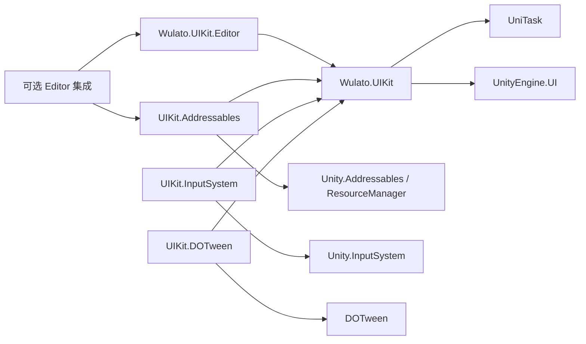
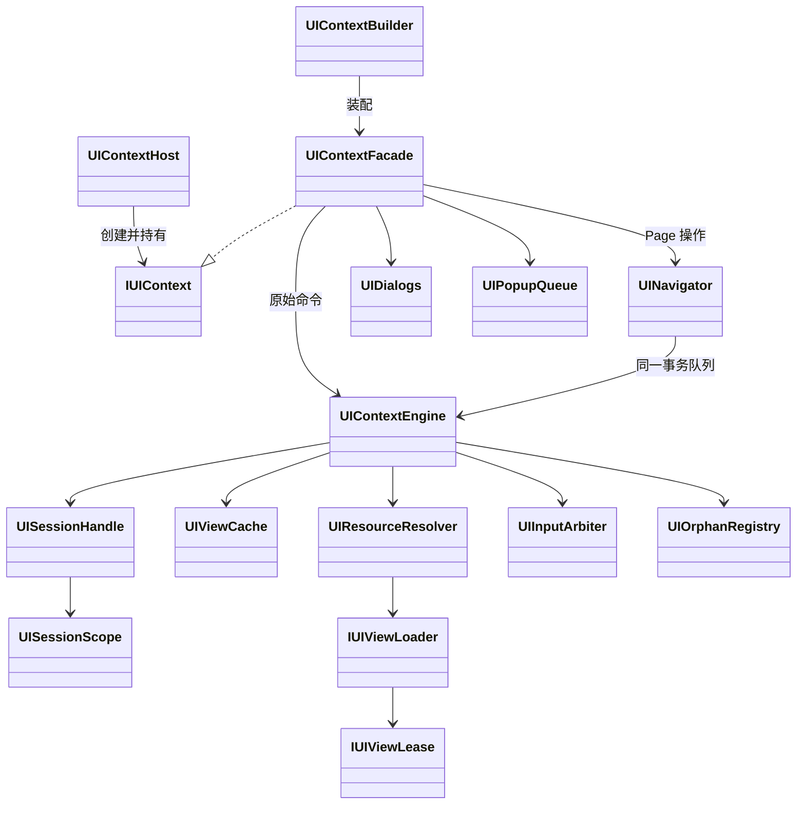

# Wulato.UIKit 0.5 架构审查与分阶段优化计划

**状态：2026-11-05 PR #1/#2/#3/#4/#5/#6 均已按用户确认合并，main 为受保护默认分支；任务 1.2 已合并，Phase 1 已合并，2.1 已合并，任务 2.2 实现与必要专项验证完成，PR #7 等待用户审核合并；2.3 尚未开始。**

**目标：** 交付一个以 uGUI 为基础、业务入口统一、生命周期可靠、只需安装一个 UIKit UPM Package 的内部框架。

**执行方式：** DEEP；当前 Agent 串行实施，每项任务独立分支、专项验收、提交及 PR，用户确认合并后继续。保留历史计划和证据，不默认启动子代理。

**依据：** 本轮用户批准的 0.5 架构与行为决策以本文件为准；原始设计 `../superpowers/specs/2026-10-31-wulato-uikit-design.md` 中未被本计划明确替代的运行时正确性契约继续有效。`../superpowers/plans/2026-11-03-wulato-uikit-master-optimization.md` 作为历史成果及证据入口保留，不覆盖其内容。验证使用 `../../Verification/README.md` 和现有执行器。

## A. 当前基线与架构审查

### A1. Git 与验证状态

2026-11-05 规划和 Phase 0 启动时均已只读核对：

| 项目 | 实际状态 |
| --- | --- |
| 当前原工作区分支 | `codex/p0-p1-preflight` |
| 已提交基线 | `a117100ee4a1ad95de410ae3eb3a70b284c11e75`，与远端同名分支一致 |
| 远端 | `github`，`git@github.com:wulato/Wulato.UIKit.git` |
| 默认分支 | `master`，`e041e0391bb3f4a560170bdb9562df3ea570abed`，初始提交；启动时不存在 main |
| 差异 | 当前分支领先 master 22 个提交，涉及 2079 个文件 |
| 开放 PR | 启动时没有 |
| Worktree | 规划时只有原工作区；Phase 0 使用一个干净 worktree 保留脏目录 |
| Unity | `2022.3.62f2` |
| 包版本 | 主包/Input System 0.4.0，Addressables 0.2.0 |

未提交内容必须保留且不纳入稳定基线：根 manifest/lock（包括 uGUI 从 1.0.0 改为 2.0.0）、ProjectSettings（EVO_UI）、四个验证工具/测试文件、旧计划执行记录、未跟踪 Evo UI/TMP 资产和元数据。用户已选择仅导入已提交内容。这些修改不得被覆盖、自动提交或当作 a117100 的验证输入。

现有验证体系包含 suite 选择、隔离宿主、源码指纹、必需用例、原始日志和证据校验，应复用。历史 M6 安装补验不等于移动发布通过。旧计划末尾的真实专项补验仍记为进行中；类别筛选问题的自动修复计数为 **1**，移交不能重置。原工作区未提交修复不自动引入本基线；若基线验收复现相同问题，先核对已有修复并记录独立任务，不重复无证据修复。

规划轮仅执行只读 Git/远端查询、源码与测试结构检查、文档和证据索引核对、官方资料研究及 git diff --check（通过）；未运行 Unity/Python 测试、性能测试、Player 构建或安装第三方包。后续实际验证另记执行记录，不沿用规划轮结论。

### A2. 模块盘点

以下路径相对 `Packages/com.wulato.uikit/`；独立适配包另标明。审查覆盖所有 UIKit 模块的源码结构、关键执行链、测试目录与必需用例配置；架构静态审查不构成全部运行时行为已通过的证明。

主包 Runtime：80 个 C# 文件、4368 行；Editor：22 个文件、1537 行。重构依据是职责和接入成本，不是行数。

| 模块、源码位置 | 已实现职责/依赖 | 维护成本与问题 | 0.5 处理与保留能力 |
| --- | --- | --- | --- |
| Core：Runtime/Core/ | 注册快照、参数、错误、Session、缓存、生命周期；UnityEngine/UniTask | 中高；复杂度主要来自正确性 | 保留逻辑边界，隐藏内部协议 |
| Engine：Core/Sessions/UIContextEngine.cs、Transactions partial | FIFO、开关、提交回滚、Shutdown、输入协调 | 高；已有 partial 分工 | 保留唯一内核，区分内部原始打开与公共导航 |
| Facade/Builder：UGUI/UIContextFacade.cs、UIContextBuilder.cs | Root 所有权、装配、失败回滚、转发 | 中；显式模块装配增加步骤 | 保留装配所有权，业务服务默认装配 |
| Host：UGUI/UIContextHost.cs | Inspector 启动、幂等初始化、有界停止、Reload | 中高；不同于 RuntimeHost | 保留场景装配，不吞并迟到清理宿主 |
| Session/Scope：Core/Sessions/、Scopes/ | 每次打开身份、共享 Closed、资源跟踪、前台作用域 | 中；不同 Scope 表示不同寿命 | 保留 Session/Foreground 与逆序清理 |
| Queue/Transaction：Core/Async/、Transactions/ | 单次消费、通知隔离、取消竞争、原子替换 | 高；部分公开协议用于跨程序集 | 协议转 internal，保留 FIFO/提交门/单次观察 |
| Registry/Loading：Core/UIRegistry.cs、Runtime/Loading/ | 类型映射、Prefab/Resources、租约 | 中；默认与 Addressables 回退分发重复 | 内部统一路由，保留显式 key/类型校验/租约 |
| Navigation：Runtime/Navigation/ | Push/Back、描述符历史、配对转场、事务发布 | 中；缺 Replace/PopTo，输入 Back 分离 | 扩展现有 Navigator，不保存旧 View |
| Dialogs：Runtime/Dialogs/ | 请求映射、Session responder、结果与 Closed 屏障 | 中；额外 Registry/装配样板 | 统一注册来源，保留结果/取消/关闭错误区分 |
| PopupQueue：Runtime/PopupQueue/ | 优先级、FIFO、去重、暂停、不抢占、停止 | 中；入口底层、缺单请求取消 | 泛型入口和取消复用现有队列 |
| Presentation：Runtime/Presentation/ | 每 Session Presenter、失败解绑、外部 Model 所有权 | 低，约 56 行 | 保留可选，不强制业务架构 |
| Input：UGUI/Input/、独立 input-system 包 | 单域仲裁、Modal 屏障、按住隔离、焦点、事件清理 | 高；遍历/分配需实测 | 保留安全链路，隐藏内部跟踪器，不仅切 CanvasGroup |
| Transition：Core/Transitions/、UGUI/Transitions/ | 写集、基线、同步 Stop、自研帧执行 | 中；现有协议可承载 Tween | 保留协议/Immediate，DOTween 替代通用执行器 |
| 独立 addressables 包 Runtime/ | 唯一位置、非激活实例化、租约、销毁后释放 | 中高；已有所有权测试 | 迁主包可选程序集，保留取消与释放时序 |
| Editor/Authoring/、Binding/、Registry/ | Workbench、生成/路由/指纹/Undo/续跑/预览恢复 | 中高；安全保护不可直接删除 | 扩展已有工具，不重写编辑器 |
| Tools/Verification/、Verification/ | 选择、隔离、矩阵、证据、构建与设备 | 高；包/程序集迁移影响映射 | 随任务更新，远端/移动门禁最后处理 |

### A3. 结论与优先级

- **P0 安装/装配：** 主包已有七个 Runtime 程序集、四业务模块；用户选择收敛基础 Runtime，减少跨程序集公共协议。
- **P0 资源来源：** Addressables 手工注入 Loader 改为 Registry 来源驱动。
- **P1 导航/返回：** 扩展已有事务和 Navigator，不增加第二套生命周期。
- **P1 可选编译：** Runtime/Editor/Tests/Samples 分别隔离，不能只给源码加 #if。
- **P2 体验/生态：** 契约稳定后完善模板、动画、绑定示例。
- **性能观察：** Gate 遍历、输入驱动数组、仲裁 LINQ、类型查找需测量；无已确认瓶颈或零 GC 承诺。

## B. 技术选型与推荐结论

第三方兼容性须用锁定版本实际验证；本表是工程选择，不是安装或验收结果。

| 能力 | 当前/候选 | 推荐 |
| --- | --- | --- |
| 生命周期/取消/所有权 | 现有 Engine、整体替换、重新自研 | 保留并收敛已有内核，避免重做复杂竞态正确性 |
| 简单 API | Context、QFramework.UIKit | 借鉴直观入口，不集成整套 QFramework；返回 Session，不暴露缓存 View |
| 导航 | 当前 Navigator、UnityScreenNavigator | 改进当前实现，参考页面流/配对动画，不叠加两套屏幕生命周期 |
| Transition | 当前 Runner、DOTween/Pro | 集成可选 DOTween，候选 1.3.045；Pro 非必需，0.5 暂无独立 Pro 播放适配 |
| 绑定 | 手写事件、R3、自研 | 可选 R3 示例，session.Track(subscription)，不自研 Observable/路径绑定 |
| 复杂列表 | ScrollRect、FancyScrollView、自研 | 默认 ScrollRect；候选 FancyScrollView 1.9.0 提供示例，不做统一列表引擎 |
| 控件 | uGUI、UI Extensions、Evo | 按需直接使用成熟控件；UI Extensions 仅指南/兼容检查，不加核心依赖 |
| Theme | 自研、Evo Styler | 不自研；本地 Evo 1.9.9 项目侧评估，官方 v2 最低 Unity 6 且不能直接从 v1 升级，本轮不升级 |
| Localization | 自研字典、Unity Localization | 优先官方组件，可选示例；Session 约束手工异步更新，不建语言包系统 |
| Focus/Gamepad | Gate、Selectable、Evo | 保留 Gate，复用 Selectable/Input System，先做默认焦点/恢复示例 |
| 渲染/编辑 | uGUI、FairyGUI、UI Toolkit | 继续 uGUI；不迁移 FairyGUI 资产/渲染，不加第二 Runtime 后端，不重写 Workbench |

整体方案：全部保留边界迁移风险低但接入负担不变；整体替换无法证明更省维护；**用户已选择基础 Runtime 收敛、可选适配隔离**，接受基础运行时统一重编译。

官方参考（2026-11-05 已查阅）：

- [QFramework UIKit 源码](https://raw.githubusercontent.com/liangxiegame/QFramework/master/QFramework.Unity2018%2B/Assets/QFramework/Toolkits/UIKit/Scripts/UIKit.cs)
- [UnityScreenNavigator](https://github.com/Haruma-K/UnityScreenNavigator)
- [DOTween 下载/版本](https://dotween.demigiant.com/download.php)、[API](https://dotween.demigiant.com/documentation.php)
- [R3 Unity 安装](https://github.com/Cysharp/R3#unity)：NuGet DLL 与 R3.Unity 两步，不能声称只加一个 Git 包即可
- [FancyScrollView](https://github.com/setchi/FancyScrollView)：FancyScrollView 与 FancyScrollRect/Grid 的循环/吸附能力不同
- [Unity UI Extensions](https://github.com/Unity-UI-Extensions/com.unity.uiextensions)
- [Evo v2 变化](https://docs.michsky.com/docs/evo-ui/new-in-v2)
- [Unity Localization 1.4](https://docs.unity3d.com/Packages/com.unity.localization@1.4/manual/QuickStartGuideWithVariants.html)
- [FairyGUI](https://github.com/fairygui/FairyGUI-unity)、[Unity 2022.3 UI 对比](https://docs.unity3d.com/2022.3/Documentation/Manual/UI-system-compare.html)
- [Unity asmdef 格式](https://docs.unity3d.com/2022.3/Documentation/Manual/AssemblyDefinitionFileFormat.html)
- [Addressables 加载所有权](https://docs.unity3d.com/Packages/com.unity.addressables@1.21/manual/LoadingAddressableAssets.html)

## C. 目标架构与公共契约

### C1. 单 Package 与程序集

唯一 UIKit Package 为 `com.wulato.uikit`。必需依赖仍为 uGUI/UniTask 2.5.11。用户允许外部必需依赖；一个 UIKit 包不代表自动安装所有 SDK。文档明确 UniTask 的 Git/内部源解析方式。

```text
Packages/com.wulato.uikit/
  package.json
  Runtime/
    Wulato.UIKit.asmdef
    Core/ Loading/ UGUI/ Navigation/ Dialogs/ PopupQueue/ Presentation/
    Integrations/
      Addressables/    # 独立 asmdef
      InputSystem/    # 独立 asmdef
      DOTween/        # 独立 asmdef
  Editor/
    Wulato.UIKit.Editor.asmdef
    Authoring/ Binding/ Registry/ Diagnostics/
    Integrations/     # SDK 专属校验，独立 asmdef
  Tests/              # 保留行为 suite
  Samples~/           # QuickStart、BusinessFlow、Addressables、DOTween、R3、FancyScrollView
  Documentation~/
```



- 基础 Runtime 不引用可选 SDK 或 UnityEditor。删除原七个基础 asmdef，保留目录边界；事务/Shell/调度/输入跟踪实现转 internal，不提供空壳兼容程序集。
- SDK 引用使用程序集名称，不依赖消费项目 GUID。
- Addressables/Input System 的 Runtime、Editor、Tests 各自声明 Version Defines/Constraints；符号不跨 asmdef 自动传播。
- 首批锁定 Addressables 1.21.21、Input System 1.17.0；未验证版本明确提示，不自动升级 SDK。
- DOTween 使用显式集成符号；先核对 SDK/官方程序集配置，不能仅凭全局 DOTWEEN 符号假定可引用。
- SDK 缺席时相应适配不编译；基础 Editor/默认样例无适配类型引用。条件声明不替代真实干净编译。

### C2. 核心对象关系



Facade 是唯一公共业务入口，Engine 不再实现公共 IUIContext。Host 管装配，Engine 管逻辑生命周期，RuntimeHost 管 Root 销毁后的通知/迟到清理。Navigation/Dialogs/PopupQueue 默认装配，Presenter 显式可选。保留 Loader/Transition/Observer 扩展点；低层事务不继续作为公共通用协议。不新增 DI 容器、自动扫描或全局 Context。

### C3. 生命周期与资源流程

```text
请求 → 主线程/参数校验 → Context FIFO
 → 加载/取缓存 → 新 Session
 → OnCreate（仅新实例，保留先于 Awake 的契约）
 → 隐藏挂载 → Presenter/Observer → OnOpen
 → Layout → Enter/配对动画 → 原子提交页面/历史/输入 → 返回 Session

关闭 → 撤销输入/Foreground → 取消 Session Token
 → 终结观察者/释放 Session 绑定 → OnClose → Exit → OnClosed
 → 缓存或释放实例/Lease → Closed
```

保留：原始异步任务单次消费，共享 Closed/关闭/Shutdown 完成源；缓存重开新 Session；旧 responder/句柄/订阅不影响新会话；提交前取消回滚，提交后旧页有界关闭，Shutdown 可接管；不合作任务迟到隔离；PendingCleanup 不冒充物理释放；Shutdown 统一绝对预算；停止诊断不可变；外部 Model/SDK/注入依赖不转移所有权。

```text
Registry addressables → Build 校验后端 → Resolver
 → Locate 唯一地址/GUID → LoadAssetAsync
 → 非激活父节点实例化 → Lease 拥有克隆/句柄
 → 缓存保留 → 实际销毁克隆后 Release
```

复用现有查询释放、失败回滚与迟到清理，不混换实例化/释放体系。内部 UIResourceResolver 复用 IUIViewLoader，集中 Prefab/Resources/External 分发。第一方适配受控初始化注册工厂，每 Context 取得独立快照；不扫描、不共享 View/Lease。运行时标准启动阶段注册，Editor 由适配 Editor 初始化；幂等并支持 Reload。缺失后端在分配前报错。

### C4. 公共 API 与导航

保留 Async 命名和强类型参数。`UIContextHost.UI` 为主入口；Initialize 仍返回 IUIContext。

```csharp
var ui = host.Initialize();
var home = await ui.OpenAsync<HomeView>();
await ui.PushAsync<InventoryView, InventoryArgs>(args, ct);
await ui.BackAsync(ct);
await ui.ReplaceAsync<SettingsView>(ct);
await ui.PopToAsync<HomeView>(ct);
await ui.CloseAsync(home);
var answer = await ui.DialogAsync(new ConfirmPurchase(productId), ct);
var popup = await ui.PopupAsync<RewardView, RewardArgs>(rewards,
    priority: 10, deduplicationKey: "daily-reward", cancellationToken: ct);
```

示例中的 home 在导航替换后可能已关闭；旧句柄重复关闭只返回自己的完成结果，不关闭后来恢复的首页。

| 入口 | 返回/规则 |
| --- | --- |
| OpenAsync<TView> / <TView,TArgs> | 保留 typed Session；Page 成功建立新根历史，其他层普通打开；类型擦除入口同样分流 |
| PushAsync<TView> / <TView,TArgs> | UniTask<IUISession>，仅 Page，追加描述符 |
| ReplaceAsync<TView> / <TView,TArgs> | UniTask<IUISession>，替换当前；空历史等价首开 |
| PopToAsync<TView>(ct) | UniTask<bool>，最近匹配历史项/原参数；缺失或已当前为 false |
| BackAsync(ct) | UniTask<bool>，顶层输入所有者弹窗优先，否则上一页；根页无动作 |
| CloseAsync(IUISession, reason) | UniTask<UICompletion>，验证 Context，不影响其他会话 |
| DialogAsync<TResult>(IDialogRequest<TResult>,ct) | DialogResult<TResult>，保留 Closed 屏障和取消 |
| PopupAsync<TView> / <TView,TArgs> | UniTask<PopupQueueResult>，泛型请求、独立取消 |
| IUISession.ContextId | 新增只读所属 Context |

- Page Open/Push/Replace/PopTo 共用 Navigator/事务/历史。新根成功提交才清旧历史，失败或提交前取消恢复旧页。
- 相同 Single 当前仍打开时 Open/Push/Replace 返回 AlreadyOpen，不隐式重载。PopTo 只重建目标，不播放跳过页的生命周期。
- Close 指定 Session 是 owner 关闭；关闭当前导航页清历史。
- Back/输入 Cancel 统一并尊重 CanClose(Back)，否决不穿透；一次最多处理一个目标。显式 Open/Push/Replace/PopTo 不额外触发用户返回确认。
- Back 在 FIFO 内路由内部导航步骤，不在钩子里嵌套公共命令。旧页关闭错误不回滚已提交历史。
- Dialog 保留 Submitted/UserCanceled/ContextStopped；false/null/default 合法，旧 responder 无效。
- Popup 等待取消移除请求；打开取消走回滚；显示后取消等待 Closed 再抛取消；去重 key 在终结屏障后释放。
- 普通异步任务只 await 一次；关闭/Shutdown 共享结果可重复等待。

### C5. 输入、动画、绑定与 Editor

Input：保留 Gate/Arbiter/Domain/驱动。Workbench 按安装依赖与 Active Input Handling 明确选择；冲突拒绝，不自动替换。运行时不创建/切换 InputModule；多 Context 显式共享输入域。

DOTween：单界面/配对适配；UIKit 管播放记录、取消、释放；只写 AnimationRoot/Opacity，默认非缩放 Update。Stop 同步 Kill 当前记录并终结等待，独立播放身份防旧回调影响重入。不 KillAll、不改业务全局配置。基础默认 Immediate；SDK 提供 preset，Host 配置单界面及配对 preset；不增加复杂每页面选择策略。

R3：不新增生产绑定引擎；复用 uGUI 扩展，订阅交 session.Track，后台通知先主线程；缓存 View 销毁不是绑定寿命。

Workbench：延续窗口/状态机/独立 PlayMode 预览，增加模板、来源、依赖状态和 Diagnostics；保留 Undo、所有权/GUID/指纹、用户代码保护和恢复。

## D. 实施任务、验收与回退

### D1. 通用执行规则

每项任务独立 PR，任务编号不是额外任务文档。保存本计划后先 Phase 0；后续从更新 main 创建 feat/*、fix/*、refactor/*、chore/*。复查当前差异和验收，逐项暂存、提交、创建 PR；不 git add .。用户确认 main 合并后开始依赖任务；回退优先整项 revert，不改远端历史。同原因最多两轮自动修复，移交保留计数。第三方安装、系统/凭据变化另行授权，计划不扩展环境权限。

以下 P=Packages/com.wulato.uikit/。移动文件包含 .meta 并记录完整移动清单。以下任务均未因计划批准自动记为已验收。

### Phase 0：稳定基线与 GitHub Flow

#### 0.1 建立 main 基线

- **目标/方案：** 从 master/e041e03 创建 main；chore/uikit-0.5-baseline 引入现有已提交历史并创建基线 PR；不改原分支/脏目录。
- **文件：** 现有 22 个提交的历史范围，本计划、AGENTS.md、README.md、Verification/README.md 的当前任务入口。
- **Breaking Changes：** 无 Runtime 变化；任务入口切 0.5，历史保留。
- **依赖：** 计划批准；main 合并仍由用户确认。
- **风险：** 大基线 PR，历史证据与脏目录指纹不同。
- **验收：** PR 除明确文档修改外与 a117100 树一致；合并后才切默认分支 main。
- **最小测试：** Git 树/差异、CLI、干净消费项目 package-install/quickstart-only；不移动发布/远端全量。
- **回退：** 不合并，保留 master 默认；不擅删新 main。

#### 0.2 串行开发约定

- **目标/方案：** 固定分支/PR/合并/证据规则。脏目录保留，可使用一个干净工作区；不自动多 worktree 并行。
- **文件：** AGENTS.md、README.md、本计划。
- **Breaking Changes：** 长期 codex 分支改短分支。
- **依赖：** 0.1 合并；合并前可以准备文档，不能宣称全部完成。
- **风险：** PR 授权被误解为 main 自动合并。
- **验收：** 按仓库能力配置 main 禁止强推/删除；Phase 6 前不强制未可用 CI。
- **最小测试：** 文档/分支/PR 设置检查。
- **回退：** revert 文档/可恢复设置，保留分支和工作区。

### Phase 1：基础架构与单 Package

#### 1.1 收敛基础 Runtime 程序集

- **目标/方案：** 新 Wulato.UIKit.asmdef 合并七个基础程序集，先不改行为；更新边界/测试/生成器。
- **文件：** P/Runtime/**.asmdef、AssemblyInfo.cs、Editor asmdef、Tests/Samples asmdef；Tools/Verification/contract_probe.py、ci_suites.py 及测试。
- **Breaking Changes：** 旧程序集引用失效；事务能力/实现 internal，无空壳。
- **依赖：** Phase 0。
- **风险：** asmdef/程序集限定类型/序列化/生成映射。
- **验收：** 无缺失脚本/GUID 变化/SDK 反向引用，生成仍在原业务程序集，无内部类型泄漏。
- **最小测试：** Python 边界、两后端编译；Legacy contracts/integration、generated-integration、loading-layout、context-host；受身份变化影响的 Host Reload。
- **回退：** 整项 revert，恢复 asmdef/引用。

#### 1.2 合并可选适配包

- **目标/方案：** 两个 SDK 适配 Runtime/Editor/Tests/文档/样例迁入主包，配置条件编译，移除独立 UIKit 适配包。
- **文件：** 两旧包目录、P/Runtime/Integrations/、Editor/Integrations/、Tests/Integrations/、package.json；runtime.py、build.py、matrix.json 及测试。
- **Breaking Changes：** 删除旧 UIKit 包引用，SDK 仍项目安装；保留脚本 GUID。
- **依赖：** 1.1。
- **风险：** SDK 缺席 asmdef、Editor/Sample 泄漏、重复类型。
- **验收：** 四依赖组合实际编译，基础安装无可选 SDK，重复旧包有迁移提示。
- **最小测试：** 四组合编译/package-install；addressables-runtime/integration；input-package/input-runtime，无全 suite。
- **回退：** revert，按记录恢复消费 manifest，不删 SDK/用户资产。

#### 1.3 统一资源路由

- **目标/方案：** UIResourceResolver 分发 Prefab/Resources/External；适配注册工厂，Registry 来源驱动，无普通 Loader 注入。
- **文件：** 新 P/Runtime/Loading/UIResourceResolver.cs、Core/UIRegistry.cs、Builder、Addressables Loader/Bootstrap、Editor 来源校验、新 ResourceResolverTests.cs。
- **Breaking Changes：** Addressables 默认无 WithLoader；自定义高级入口保留。
- **依赖：** 1.2。
- **风险：** Reload 注册、共享状态、缺后端报错时机。
- **验收：** 同 Registry 三来源，多 Context 快照隔离；分配前校验；取消/缓存/销毁后释放保持。
- **最小测试：** contracts、loading-layout、addressables-runtime/integration；幂等/Reload 定向。
- **回退：** revert 路由，恢复显式注入，资源 key 不改写。

### Phase 2：业务 API 与导航

#### 2.1 入口及默认装配

- **目标/方案：** Facade 唯一 IUIContext、Engine 内部命令；默认三业务服务，host.UI、ContextId、统一 Dialog 注册。
- **文件：** IUIContext/IUISession/Session 包装、Facade/Builder/Host、UIRegistry、Dialogs/生成器、新 ContextApiTests.cs。
- **Breaking Changes：** Context→UI；无需 UseNavigation/Dialogs/PopupQueue，移除重复入口/公开事务。
- **依赖：** 1.3。
- **风险：** 构造顺序、回滚、公共 Open 递归。
- **验收：** 业务无需 GetService；工厂逆序释放，内置服务不可覆盖；跨 Context Close 无副作用；Presenter 可选。
- **最小测试：** contracts/integration/sessions/context-host/dialogs/popup-queue/presentation 直接受影响用例。
- **回退：** revert，恢复显式装配，不保留两套长期入口。

#### 2.2 页面 Open/Push/Replace/PopTo

- **目标/方案：** 现有 Navigator 统一历史，复用 Prepare/Animate/CommitReplacement。
- **文件：** IUINavigator/UINavigator、Facade、UIContextEngine.Pages.cs、NavigationFlowTests/NavigationTransactionTests。
- **Breaking Changes：** Open(Page) 新根，新增 Replace/PopTo，按 C4。
- **依赖：** 2.1。
- **风险：** 失败清历史、取消/提交竞争、重复类型/参数。
- **验收：** 一套事务；提交前回滚焦点/历史，提交后错误不伪装未提交；Modal 不入历史/不误关。
- **最小测试：** navigation EditMode、transitions 页面用例/flow-integration PlayMode；补必需用例。
- **回退：** revert，恢复旧 Push/Back 及样例。

#### 2.3 统一 Back/Cancel

- **目标/方案：** FIFO 内弹窗优先、CanClose、页面返回、根页 no-op；内部步骤避免嵌套提交。
- **文件：** Engine 用户请求、Facade、Navigator、Arbiter 注册、输入/导航测试及联合用例。
- **Breaking Changes：** Cancel 不直接关闭导航页清历史，改统一 Back。
- **依赖：** 2.2。
- **风险：** 穿透、否决继续下传、按住连发、Shutdown/转场锁竞争。
- **验收：** 一次一个目标，否决不退页，根页稳定，两后端新边沿正确，Context 隔离。
- **最小测试：** 两后端 input-runtime；navigation/flow-integration 定向。
- **回退：** revert 返回路由，保留已交付导航，不旁路 Gate。

#### 2.4 Dialog/Popup 入口与取消

- **目标/方案：** DialogAsync/泛型 PopupAsync，统一注册；Popup 独立取消和去重屏障。
- **文件：** Dialogs/PopupQueue、Facade、DialogLifecycleTests/PopupSchedulingTests。
- **Breaking Changes：** 普通业务无需 IPopupRequest/单独 DialogRegistry，结果保留。
- **依赖：** 2.1，2.3 合并后实施。
- **风险：** 取消/提交/Closed/key 释放竞态。
- **验收：** false/null/旧 responder、暂停/打开/显示取消、其他请求推进、错误/PendingCleanup 可见。
- **最小测试：** dialogs/popup-queue EditMode，flow-integration 真实关闭/Shutdown。
- **回退：** revert 入口和取消任务，保留原语义。

### Phase 3：成熟组件

#### 3.1 DOTween 与 Presets

- **目标/方案：** 单界面/配对、Fade/Scale/Slide 与示例；迁移用途后移除通用 UITransitionRunner。
- **文件：** Runtime/Integrations/DOTween、基础 preset/Host 配置、旧 Runner、Tests/Integrations/DOTween、Samples~/DOTween。
- **Breaking Changes：** Runner 移除，IUITransition 扩展保留。
- **依赖：** Phase 2；SDK 安装另行授权。
- **风险：** Kill/Complete 重入、Sequence 时间、Stop 后写入、缺 SDK。
- **验收：** Stop 同步终结/无写入，重入/多 Context 隔离，仅复位声明属性；无 SDK Immediate 正常。
- **最小测试：** DOTween 专项、受影响 transitions/导航取消超时、无 SDK 编译、静态状态相关 Reload。
- **回退：** revert 适配/Runner 移除，不改用户 SDK/全局 Tween。

#### 3.2 R3 Session 绑定示例

- **目标/方案：** 候选 R3/R3.Unity 1.3.1，订阅纳入 Session.Track，无绑定引擎。
- **文件：** Samples~/R3、可选测试、Documentation~/Integrations/R3.md。
- **Breaking Changes：** 无核心 API 变化。
- **依赖：** 2.1；SDK/DLL 安装另行授权。
- **风险：** NuGet 不完整、缓存解绑遗漏、后台 UI。
- **验收：** 重开无重复订阅、结束不更新、Model 不释放、无 R3 主包可编译。
- **最小测试：** 绑定专项/presentation 相关场景，不完整生命周期回归。
- **回退：** revert 示例文档，不自动卸载第三方。

#### 3.3 FancyScrollView 与控件边界

- **目标/方案：** 候选 1.9.0，固定尺寸大数据/动画列表示例；UI Extensions 仅指南，不包装控制器。
- **文件：** Samples~/FancyScrollView、可选测试、Documentation~/Integrations/Controls.md。
- **Breaking Changes：** 无。
- **依赖：** Phase 2；安装另行授权。
- **风险：** 复用异步串项、拖拽/Modal 冲突。
- **验收：** Cell 数随视口、换项取消/身份校验、Session 结束回调无效、默认样例无 SDK。
- **最小测试：** 列表专项、ScrollRect/Modal 输入场景；记录局部性能不扩大声明。
- **回退：** revert 示例，继续原 ScrollRect。

### Phase 4：Workbench 与体验

#### 4.1 模板/来源/初始化

- **目标/方案：** 扩展已有窗口，Page/Modal/Dialog/可选 Presenter 模板，来源/驱动选择，Host presets。
- **文件：** Workbench、UIViewAuthoring、UIAuthoringOperation、UISceneAuthoring、Marker/生成器/SDK Editor 校验。
- **Breaking Changes：** 新模板用 0.5；Page Single/Release，Modal/Dialog Multi/Release；旧资产策略不静默更改。
- **依赖：** Phase 2、3.1。
- **风险：** 续跑覆盖文件、SDK 推断、GUID 变化。
- **验收：** 首页无需模块装配；幂等/冲突先报/Undo/原业务程序集/用户 partial 保护。
- **最小测试：** authoring/editor/generated-integration/quickstart-only，两输入配置。
- **回退：** revert 工具，不改已生成用户资产，按迁移说明处理。

#### 4.2 Diagnostics/预览

- **目标/方案：** Workbench 显示 Context/Session/历史/缓存/输入/锁/错误/PendingCleanup，延续独立 PlayMode 预览。
- **文件：** 新 Editor/Diagnostics/UIDiagnosticsPage.cs、Workbench、Preview Profile/Runtime/Page、必要诊断快照字段。
- **Breaking Changes：** 预览统一资源装配，不需 Addressables Loader Adapter。
- **依赖：** 4.1。
- **风险：** live View 保留、停止快照误判实时、恢复覆盖场景。
- **验收：** 无可写运行对象，标注终态采样；重开新 Session，保存取消/资产保护。
- **最小测试：** diagnostics/preview-authoring/runtime/context-host，保留受影响 Reload 要求。
- **回退：** revert UI，不删除用户改过临时资产。

### Phase 5：有限高级能力

#### 5.1 Localization/Theme/Focus 指南

- **目标/方案：** Unity Localization 候选 1.4.5 示例；Theme 项目侧 Evo 1.x/其他 Styler；Focus 原生 Selectable/恢复；不建新框架。
- **文件：** Samples~/Localization、Documentation~/Integrations/Localization.md、ThemeAndFocus.md、可选夹具。
- **Breaking Changes：** 无，不升级现有 Evo。
- **依赖：** Phase 4；安装另行授权。
- **风险：** 切语言迟到、关闭订阅、Styler 越门控、控件自建输入模块。
- **验收：** Session 结束异步更新无效，不改 Shell；依赖缺席主包正常。
- **最小测试：** 本地化专项/焦点 Modal 恢复/门控。
- **回退：** revert 示例指南，不迁移主题资产。

### Phase 6：交付与发布

#### 6.1 文档/安装/迁移

- **目标/方案：** 主包 0.5.0，完整 Breaking Changes/安装/业务流/可选集成/旧包移除；固定提交分发。
- **文件：** package.json、CHANGELOG/README、Migration-0.5.md、Samples/快照配置。
- **Breaking Changes：** 汇总已有变化，不额外兼容层。
- **依赖：** Phase 1–5。
- **风险：** 全局忽略漏收 ~ 目录，消费端脏文件补齐。
- **验收：** 固定提交含所有授权文件/样例/文档/meta；干净项目一个 UIKit 包选择能力。
- **最小测试：** 四组合安装编译、QuickStart/BusinessFlow 生成运行、SDK 示例独立验收。
- **回退：** 不发布，消费保持旧确认提交。

#### 6.2 远端 CI/完整 Editor

- **目标/方案：** 现有 CI 更新路径/身份/映射；普通按影响，发布显式完整，下载 artifact 复核。
- **文件：** uikit-checks.yml、ci_suites.py、证据/门禁配置及测试。
- **Breaking Changes：** CI 不认旧适配包，证据 0.5 身份。
- **依赖：** 6.1，输入冻结。
- **风险：** 漏选/缺上传/指纹漂移/self-hosted。
- **验收：** 真实远端链路，失败证据保留，零匹配/跳过/缺证据失败。
- **最小测试：** Python 相关→远端专项→默认编辑器两后端完整适用 Editor/Reload 门禁。
- **回退：** revert CI，保留失败，不放宽门禁。

#### 6.3 移动/性能/Release Gate

- **目标/方案：** 现有执行器 Android/iOS ARM64 IL2CPP、真机输入/释放/性能。
- **文件：** mobile workflow、build.py/smoke.py、release gate/Verification 移动夹具。
- **Breaking Changes：** 无新增业务契约。
- **依赖：** 6.2；SDK/签名/设备/环境授权。
- **风险：** AOT/裁剪/触摸手柄/SDK 释放/签名设备。
- **验收：** 冻结提交两平台两输入适用矩阵，覆盖导航/Dialog/Popup/Addressables/取消/缓存/Shutdown；性能注明设备/采样边界。
- **最小测试：** 本任务完整发布门禁；额外 Unity 版本仅新增支持声明时加入。
- **回退：** 不发布，不用 Editor 替移动；修复按影响复验，最终证据匹配发布指纹。

### D2. 验证配置与顺序

```sh
python3 Tools/Verification/run.py tests --editor 2022.3.62f2 --backend legacy --mode EditMode --suite navigation
```

每任务明确 suite/mode/backend，阶段完成不自动 suite all。结构迁移需要受影响源码实际编译，不表示所有用例重复运行。

| 编译组合 | SDK | 输入 |
| --- | --- | --- |
| C0 | 无 | Legacy |
| C1 | Addressables | Legacy |
| C2 | Input System | Input System |
| C3 | Addressables + Input System | Input System |

输入/Back 另验 Both 下明确选择两驱动，不扩大全部 suite。DOTween/R3/Fancy/Localization 各自任务验证有/无依赖。

顺序：0.1→0.2→1.1→1.2→1.3→2.1→2.2→2.3→2.4→3.1→3.2→3.3→4.1→4.2→5.1→6.1→6.2→6.3。

最高风险：程序集身份/可选隔离；公共 Page Open 递归/重复生命周期/提前历史；Back 输入重入；Addressables 过早释放；DOTween Stop 重入；脏目录/历史证据误入基线。

## E. 非目标与批准边界

不做第二套页面/动画/生命周期、全局默认 Context、强制业务架构/R3、通用动画/Observable/虚拟列表/控件库、自研渲染器、FairyGUI/UI Toolkit 第二后端、重写 Workbench/完整编辑器/Source Generator、DI/扫描模块体系、主题语言/焦点树/输入管理器、Evo v2/Unity 6 升级、自动采购/内嵌 SDK、远端资源平台/热更新/持久历史、长期兼容层/空壳包、默认完整矩阵/移动构建、无测量性能重写/零 GC 承诺。

计划批准后先 Phase 0，不直接 Phase 1。每项 main 合并用户确认。历史文档/证据保留，进度/决策/验收集中记本文件。

## F. 执行记录

### 2026-11-05 Phase 0 启动

- [x] 用户指令“开始执行 plan”批准已审查的方案；只推进 Phase 0，停在 main 合并门禁。
- [x] 重新核对本地/远端：a117100、master/e041e03，无 main/开放 PR，原脏目录与审查一致。
- [x] 通过原生 create_worktree 创建一个干净工作区 `/Users/tian/.codex/worktrees/uikit-05-baseline/Wulato.UIKit`，分支 `chore/uikit-0.5-baseline`。原目录所有用户修改保留。
- [x] 保存本计划；后续证据保存在该工作区 `Artifacts/uikit/phase0/`。
- [x] 核对基线树：相对 a117100，生产源码、资产、项目配置、验证工具及宿主跟踪文件零差异；仅计划与三份工作流入口文档变化。
- [x] 最小实际验收通过：Unity 2022.3.62f2/Legacy；主包干净宿主 prepare 退出 0，package-install EditMode 2/2，QuickStart 8 个跨编译准备/幂等步骤及 PlayMode 1/1，全部无失败/跳过。
- [x] 原始证据以当前快照复核：两个 suite 的 XML/trace/哈希/必需用例 PASS，汇总 [verification.json](../../Artifacts/uikit/phase0/verification.json)。命令日志与退出码在同目录。
- [x] 创建 main/e041e03；远端默认分支仍为 master，没有合并或改写已有功能分支。
- [x] 提交并推送文档（首提交 0dff1e3），创建 [基线 PR #1](https://github.com/wulato/Wulato.UIKit/pull/1)，base=main、head=chore/uikit-0.5-baseline；未合并。后续仅补本执行记录。
- [x] 用户确认后普通合并 PR #1，切默认 main、配置保护并开始 0.2；详情见下方收尾记录。

Ruling：基线任务分支直接从 a117100 建立，而 main 从其祖先 e041e03 建立；这与从 main 引入现有分支的普通快进结果一致，避免新增无内容合并提交。PR 树仍按 a117100 加本次明确文档差异核验。

Ruling：本任务仅迁移 Git/文档，遵循用户单 Agent、现有计划记录和最小验证约定，不额外创建 SDD 账本、执行新 hook 或启动独立审查代理。生产代码变化为零，相关运行验收证明导入基线可消费，不用机械文档 TDD 制造测试。

验证命令（cwd 为上述干净工作区；日志保留真实退出码）：

```sh
python3 Tools/Verification/run.py prepare --phase runtime --package-set main --editor 2022.3.62f2 --backend legacy --host-root Artifacts/uikit/ci-selected/hosts/phase0-baseline
python3 Tools/Verification/run.py tests --editor 2022.3.62f2 --backend legacy --mode EditMode --suite package-install --host-root Artifacts/uikit/ci-selected/hosts/phase0-baseline
python3 Tools/Verification/run.py prepare-samples --editor 2022.3.62f2 --backend legacy --quickstart-only
```

原始目录：`Artifacts/uikit/20261105T075018038615-prepare-c2830d`、`20261105T075128412604-tests-2b6adc`、`20261105T075138081357-quickstart-consumers-319fbc`、`20261105T075239618242-tests-76ee44`（后三项同在 Artifacts/uikit 下）。本次未发生测试失败或代码修复，修复次数 0；原目录历史类别筛选问题计数 1 单独保留。未运行额外编辑器、Input 后端、全 suite、远端 CI、Player/IL2CPP、真机。

Ruling：基线 PR 会引入历史 workflow，HEAD 文档提交使用 `[skip ci]` 避免 pull_request/push 自动触发远端流水线，符合远端 CI 留到 Phase 6 的边界；不修改 workflow 或禁用仓库 Actions。[GitHub 官方说明](https://docs.github.com/en/actions/how-tos/manage-workflow-runs/skip-workflow-runs)。若未来配置必需检查，跳过可能留下 Pending，不应绕过门禁；Phase 0 main 合并仍由用户确认。

GitHub 连接器创建分支返回 403（Resource not accessible by integration）；已用现有 gh 账户完成获准的创建操作，没有扩展连接器权限。

集中作者自审：本次差异仅四份文档，生产树与已验证输入未变；本地链接/18 项任务字段/代码围栏/空白检查通过。原工作区仍在 codex/p0-p1-preflight，8 个已修改文件与 Evo/TMP 未跟踪资产均保留，未暂存、提交或清理其内容。未启动子代理；未执行新 hook。干净 worktree 保留供 PR 反馈使用。

以上为基线准备时的历史记录；PR #1 的后续合并与设置结果见下节。本地验证材料不冒充远端 artifact 或发布验收。

### 2026-11-05 Phase 0.2 GitHub Flow 收尾

- [x] 用户明确确认“合并 PR #1，切换默认分支为 main 并配置保护，然后按计划继续下一项任务”。
- [x] 合并前重新核对 PR #1 OPEN/CLEAN、HEAD=`7c1d9a88747b4dbd7defdbb8583528a41231cc2e`；使用 `gh pr merge --merge --match-head-commit` 普通合并，无管理员绕过、无分支删除。
- [x] PR #1 合并提交=`7b88f696b62ba707ec82f43186ecfb2b4e46cf0a`；远端 default_branch=main，master/原开发分支保留。
- [x] main 保护：required_pull_request_reviews 已配置，required_approving_review_count=0，dismiss_stale_reviews=true；enforce_admins=true；allow_force_pushes=false；allow_deletions=false；required_status_checks=null。
- [x] 从更新后的 github/main 建立 `chore/uikit-0.5-github-flow`，复用当前干净 worktree，不新建工作区、不触碰原脏目录。
- [x] 更新 AGENTS/README/验证入口与本计划，避免继续引用“PR #1 未合并/默认 master”的当前状态；历史记录保留。
- [x] 文档/远端配置 L0 核验通过：[verification.json](../../Artifacts/uikit/phase0/github-flow/verification.json)；合并树与 7c1d9a8 完全一致，四份文档以外的生产树未改。
- [x] 提交 fc71fd4 并推送任务分支，创建 [收尾 PR #2](https://github.com/wulato/Wulato.UIKit/pull/2)（main ← chore/uikit-0.5-github-flow），等待用户确认合并；随后仅补本条 PR 记录，不改生产树。
- [x] 用户后续明确确认合并 PR #2 并执行 1.1；以普通 merge 合并为 `417d52e870a76c378a0db8552753fcf741f7f90e`，从最新 github/main 建立下一任务分支。

Ruling：保护规则强制 PR，但必需批准数为 0，不要求第二个 GitHub 账号为同账号代理创建的 PR 批准。用户明确的合并确认仍由会话工作流执行，零批准不是自动合并授权。Phase 6 前不新增 required CI checks，不修改或禁用历史 workflows。

本任务档位 STANDARD（配置与文档收尾），验证为 L0：远端 PR/默认分支/保护字段读取、合并树与已验收基线比较、局部文档链接/计划字段/差异检查；不新增或重复 Unity、Python suite、Player 或远端 CI。证据保存在 `Artifacts/uikit/phase0/github-flow/`。本次代码修复次数 0；历史类别筛选修复次数 1 原样保留。

**下一动作：** 本收尾 PR 合并后，从最新 main 创建 `refactor/uikit-0.5-runtime-assembly` 执行任务 1.1；不将本次配置核验扩大为程序集迁移验收。

### 2026-11-05 任务 1.1 实现与专项验证

- 基线 `417d52e870a76c378a0db8552753fcf741f7f90e`；分支 `refactor/uikit-0.5-runtime-assembly`，复用当前 worktree，原用户脏目录不动。
- [x] 结构用例 RED→GREEN：七个基础 asmdef 收敛为根 `Wulato.UIKit.asmdef`，仅引用 UniTask/UnityEngine.UI；原 Core asmdef GUID 迁移保留，不留空壳。对应定义/AssemblyInfo 删除与消费者引用同步更新。
- [x] 事务 Access/Steps/Participant/Owner 及输入记录/跟踪/Mask/DomainRegistration 设为 internal；IUIContext/View/Session/Loader/Lease/Transition/Input driver 公共扩展保留，不修改运行时控制流。
- [x] 更新包、Editor、Tests、样例和已跟踪消费夹具 asmdef；生成器/编译探针/安装与 IL 闭包校验识别新身份；suite 选择明确覆盖根 asmdef 与 .meta 的生成/Host/Input 边界，不使用 suite all。
- [x] 新增 contracts 必需用例验证同一 Runtime 身份与内部类型可见性；按当前版本配置写入 matrix，不扩大本次编辑器目标。
- [x] 受影响 Python 117/117 PASS（10 个模块），见 `Artifacts/uikit/phase1-1/python-affected.log` 与退出码文件；结构首次预期失败日志 structure-red.log 保留。
- [x] Unity 2022.3.62f2 Legacy/Input 两主包隔离宿主 prepare 编译 PASS，原始目录 `Artifacts/uikit/20261105T081319150802-prepare-8b9dec`；未安装 Addressables。随后仅补迁移文档，不改变编译源码/引用。
- [x] 保留业务脚本/Prefab/Scene/Asset 的原始 .meta；迁移前清单 `Artifacts/uikit/phase1-1/baseline.json`。允许删除的 AssemblyInfo 元数据单独列明，不把已删除 asmdef 声称为仍存在。
- [x] Legacy EditMode：contracts 20、integration 20、editor 16、package-install 2；PlayMode：generated-integration 3、loading-layout 26、context-host 10、transitions 40、flow-integration 3，全部 PASS。
- [x] Input：input-package EditMode 2、context-host PlayMode 10 PASS。合计 11 组、152 个 Unity 用例；实际用例集合逐项与必需集合完全一致，无跳过或额外类别匹配。
- [x] 真实 codegen 九阶段 PASS；两后端跨程序集编译探针 positive/negative/recovery 各三步 PASS（negative 的退出 1/CS0311 为必需的预期结果，不记失败）。
- [x] 两后端 Host Reload PASS：Legacy 0/1/2/3、Input 0/3 六组合，每组合两次真实 Play/退出，自动退出报告无旧 Context/锁/订阅。
- [x] 当前快照、XML/trace/原始文件哈希、codegen/probe 清单及 Reload 证据索引均复核 PASS，汇总 [verification.json](../../Artifacts/uikit/phase1-1/verification.json)。
- [x] 集中作者自审：Runtime C# 差异仅访问级别与友元属性收敛，无生命周期/资源/输入算法变更；脚本及序列化资产元数据保持；消费者无旧程序集引用；文档路径、代码围栏、18 项任务字段及 diff 空白检查通过。按用户要求未启子代理。
- [x] 实现提交 `c7030dc9eb167d552347a7f7225b776593fe51a6` 已推送，创建 [任务 1.1 PR #3](https://github.com/wulato/Wulato.UIKit/pull/3)（main ← refactor/uikit-0.5-runtime-assembly）；后续仅补本条进度记录。
- [x] 后续按用户确认合并 PR #3，merge commit `68dcf43499f4dd793b40708cf8411f766aa01462`；从更新 main 开始 1.2。

Ruling：同步已跟踪的四宿主消费 asmdef（包括旧 6000 夹具）仅消除悬空引用，不运行额外编辑器或扩大兼容声明。Addressables/Input System 本次仍是独立包，仅更新它们引用的基础程序集，包目录迁移留到 1.2。

Ruling：包版本暂按原锁定值保留；Breaking Change 标记为 0.5 Unreleased 开发检查点并交付 Migration-0.5，最终版本提升按 6.1，不作为已发布 0.4 patch。

Ruling：专项增加 editor/package-install、配对事务 transitions/flow-integration 和 Input 适配引用/Host 检查，因为程序集身份与 internal 边界直接影响生成、装配与跨程序集调用；仍不运行完整 suite。既有类别筛选问题的历史修复计数 1 保留，不夹带原未提交修复。所选 suite 的实际用例集合必须和该 suite 必需集合一致，额外正则匹配不能计作专项通过。

本次生产代码/测试的非预期失败修复计数：0；有意结构 RED 不是修复循环。手工汇总证据时，相对 host 路径的排序产生不同指纹；改用 runner.selected 一致的绝对路径后一次复核通过（汇总脚本调整 1 次），未改源文件、原始证据或断言，不重跑已通过测试。证据集中于 `Artifacts/uikit/phase1-1/`；执行期间不改对应验证输入，文档和进度更新不重跑无关检查。

实际验证均从仓库根目录调用现有 run.py，host-root=`Artifacts/uikit/ci-selected/hosts/phase1-1`、editor=`2022.3.62f2`：prepare runtime/main/backend all；codegen/backend legacy；上述 tests 的 mode/suite/backend；compile-probe/backend all；play-reset/backend all/scope context-host。每条命令日志和退出码在汇总目录，所有执行退出码 0。未跑 suite all、其他编辑器、远端 CI、Player/IL2CPP、真机；Addressables Runtime 集成本次未运行。

原始索引：prepare `20261105T081319150802-prepare-8b9dec`、codegen `20261105T081711745351-codegen-00b375`、compiler `contract-probes/20261105T082154587823-dc0a08`、Host Reload `20261105T082235088575-host-reset-408088`（均位于 Artifacts/uikit）；11 个 suite 原始路径逐项列于 verification.json。材料在本地保留，不冒充远端 artifact 或完整发布门禁。


### 2026-11-05 任务 1.2 合并可选适配包

- 基线 `68dcf43499f4dd793b40708cf8411f766aa01462`；分支 `refactor/uikit-0.5-optional-adapters`，复用干净 worktree，原用户脏目录不动。
- [x] Addressables/Input System 的 Runtime/Editor/Tests 迁入主包 Integrations；LocalInventory 样例、文档及变更记录同迁。删除两个旧独立包及 manifest/lock 引用；保留程序集/类型名称、脚本及资产 GUID，不留空壳。
- [x] 每个可选 Runtime/Editor/Tests/Sample asmdef 独立声明 SDK Version Defines 与 Define Constraints；主 Runtime 不反向引用 SDK，主包必需依赖不变。业务安装一个 UIKit 包，SDK 按需安装。
- [x] 验证、Git 快照、消费者与发布工具识别单包和 SDK 组合；manifest/lock 中的旧 UIKit 适配包在准备前拒绝，并提供移除旧包/保留 SDK 提示。Editor Validate/build 同样提供迁移提示；不承诺在重复 asmdef 已导致编译失败时仍能加载 Editor 提示，应先按迁移文档移除旧包。
- [x] 根 lock 仅移除两个已退休 UIKit 包节点；不整理其他历史节点。同步四个已跟踪验证宿主引用，不运行额外编辑器。
- [x] 新增安装用例检查实际 Player/Editor 程序集与 SDK 存在性对应、基础 IL 引用隔离及旧包提示；更新 package-install 必需清单。结构用例 RED→GREEN；受影响 Python 11 模块共 135/135 PASS。
- [x] Unity 2022.3.62f2 的四个全新隔离宿主 prepare 与初次 package-install 各 4/4 PASS：C0 无 SDK、C1 仅 Addressables、C2 仅 Input System、C3 双 SDK。初次 C1/C3 安装记录在后续样例/内容准备后由最终记录替代，不重复计数。
- [x] 最终 15 组、209/209 Unity 用例 PASS：四组合 package-install 各 4；C1/C3 addressables EditMode 各 5、addressables-runtime PlayMode 各 12、addressables-integration PlayMode 各 11；C0 Legacy input-runtime 43；C2/C3 input-package 各 2、input-runtime 各 45。XML 实际用例集合与必需集合完全一致，无跳过/额外类别匹配。
- [x] C1/C3 真实样例导入/生成/编译/写回/场景/验证各 9 步 PASS；各产出 2 个真实 StandaloneOSX Bundle（不是 Player 构建），内容源指纹及 5 个内容文件哈希分别复核 PASS。
- [x] 最终各 suite 当前指纹、原始索引/XML/trace/文件哈希、4 组实际程序集开关、两个样例各 34 个原始文件哈希复核 PASS，汇总 [verification.json](../../Artifacts/uikit/phase1-2/verification.json)。保留 40 份迁移 .meta 原文，5 个适配 Runtime C# 文件内容不变。
- [x] 集中作者自审：单 UIKit 包、独立条件程序集、无基础 SDK 反向依赖、无运行时算法修改；迁移说明/路径/引用、必需用例及 diff 空白检查通过。按用户要求不启子代理。
- [x] 实现提交 `b8df5ff433972a9d10d9257ef1f66f1e10ced9b3` 已推送，创建 [任务 1.2 PR #4](https://github.com/wulato/Wulato.UIKit/pull/4)（main ← refactor/uikit-0.5-optional-adapters）；本次仅补执行记录，不自动合并。
- [x] 后续按用户确认合并 PR #4，merge commit `ab69a0e5c4f2b3120b3ac57041782855be93b5ed`；从更新 main 开始 1.3。

Ruling：Version Defines 的表达式 Addressables `[1.21.21,3.0.0)`、Input System `[1.17.0,2.0.0)` 仅决定候选程序集启用范围；实际本轮验证仅 2022.3.62f2 + Addressables 1.21.21 / SBP 1.21.25 / Input System 1.17.0，不构成整个版本区间的兼容声明。无 SDK 时适配 Runtime/Editor/Tests 不参与编译；可选样例仍须 SDK。版本保持 0.5 Unreleased 开发检查点，最终提升在 6.1。

Ruling：运行时加载/租约/输入 C# 算法不变；不提前实现 1.3 的自动资源路由，Addressables 仍显式 WithLoader，输入后端仍由项目选择。文档说明卸载旧 UIKit 适配包、保留 SDK、程序集名/GUID 不变。回退以整项 revert 并恢复消费 manifest 为准，不删除 SDK、用户资产或远端历史。

失败与修复记录：Python 首次运行的 sample SDK fixture/错误文本仍沿用旧包假设，修复 1 轮后 135/135 PASS。C3 首次 Addressables integration 10/11 PASS，唯一失败为 LocalInventoryScene 路径不存在：该独立宿主未执行 prepare-samples，补齐样例准备和真实 Bundle 构建后定向复验 11/11 PASS（宿主准备修复计数 1，已解决）。不修改运行时或放宽断言；原始失败日志保留。既有类别筛选问题历史计数 1 继续保留，不夹带原目录未提交修改。

最终验证在宿主与迁移文档稳定后集中执行一次上述 15 组，`*-final.log/.exit` 为最终命令；文档澄清引起输入指纹变化，早期试验记录保留但不与最终记录重复计数。汇总脚本初版将 Addressables sample step 误当作含 returncode 字段的通用 step；依据现有 samples.py 结构，改为核对原始成功标记、编译错误及文件哈希（脚本调整 1 次），不修改生产代码/测试/原始证据，不重复跑 Unity。当前未解决代码失败 0。

实际命令均从仓库根目录调用现有 `Tools/Verification/run.py`，editor=`2022.3.62f2`，host-root=`Artifacts/uikit/ci-selected/hosts/phase1-2-c0/c1/c2/c3`（每条命令选择单一目录）。prepare runtime 的 package-set/backend 依次 main/legacy、addressables/legacy、main/input、addressables/input；C1/C3 另运行 prepare-samples/sample-set addressables、prepare/phase addressables，再执行上列 tests/mode/suite。完整命令在各原始 command.json，日志与退出码及失败修复记录集中在 `Artifacts/uikit/phase1-2/`。未跑 suite all、额外编辑器、远端 CI、Player/IL2CPP、真机；未将 asmdef 候选版本范围当作全区间验证通过。下一动作仅交付本任务 PR 并等待用户合并，不开始 1.3。


### 2026-11-05 任务 1.3 统一资源路由

- 基线 `ab69a0e5c4f2b3120b3ac57041782855be93b5ed`；分支 `refactor/uikit-0.5-resource-routing`，复用干净 worktree，不动原用户脏目录。
- [x] 新契约测试先编译 RED：UIResourceResolver 尚不存在；预期 CS0103/CS0246 及退出 1 保存在 `Artifacts/uikit/phase1-3/routing-red.log` 与原始记录。不是非预期修复。
- [x] 统一路由、适配注册、Editor 来源检查与样例迁移；默认 Builder 使用 Resolver，保留显式 Loader 覆盖。
- [x] 受影响 Python 10 模块 121/121 PASS；最终 `python-final-2.log/.exit`。CI 专项选择覆盖 Resolver/Bootstrap 的 contracts/加载/SDK/Reload，测试源仅映射直接 suite。
- [x] 最终 15 组、236/236 Unity 用例 PASS，实际集合与 matrix 必需集合完全相等，无跳过/额外类别匹配。无 SDK Legacy：contracts 27、integration 20、editor 17、package-install 4、loading-layout 26、cleanup 15，共 109。双 SDK Input：contracts 27、integration 21、editor 17、addressables 5、package-install 4、loading-layout 26、addressables-runtime 12、addressables-integration 12、generated-integration 3，共 127。
- [x] 两宿主 codegen 各 9 阶段 PASS；SDK 样例导入/生成/写回/场景/验证 9 阶段 PASS，LocalInventory 不再注入 Loader。同 Registry 的 Prefab/Resources/Addressables 实际加载、缓存新 Session、ClearCache 销毁、取消和 Shutdown 专项 PASS。
- [x] SDK 宿主真实 StandaloneOSX 内容构建 2 个 Bundle；内容源指纹和 5 文件哈希通过。这不是 Player 构建。
- [x] 两宿主 Reload option 0/3 各两轮实际 Play/退出，共 4 组/8 次，PASS；每轮记录 SDK 有/无时后端注册状态，并保留自动退出 Context/锁/订阅归零证据。
- [x] 当前最终指纹、XML/trace/原始索引/哈希、实际 SDK 程序集开关、codegen 各 37 个原始文件及样例 34 文件哈希复核 PASS，汇总 [verification.json](../../Artifacts/uikit/phase1-3/verification.json)。
- [x] 集中作者自审与 L0：四个新增脚本均含 .meta，主包 330 GUID 无重复，既有 .meta 不变；当前文档入口路径与 diff 空白检查通过。未改 Engine/FIFO/Session/Lease/取消与迟到清理算法，无基础 Runtime→SDK 反向引用；未启子代理。
- [x] 实现提交 `c69e77ace12cd71bb5918247d39ebcd4bc95281d` 已推送，创建 [任务 1.3 PR #5](https://github.com/wulato/Wulato.UIKit/pull/5)（main ← refactor/uikit-0.5-resource-routing）；本次仅补执行记录，不自动合并。
- [x] 后续按用户明确确认合并 PR #5，merge commit `d2c2a40d7163910fcdcb17a182bc37ed98b926d9`；从更新 main 开始 2.1。

Ruling：每 Context 构建时复制第一方 provider 工厂表，先验证整个 Registry，再为用到的后端各创建一个 Loader；只共享工厂，不共享 Loader/View/Lease。Engine/FIFO/取消/迟到清理不改动；Resolver 直接传递原始 UniTask，不额外消费。显式 WithLoader 覆盖整个路由，依赖仍调用方所有，保留自定义 backend 高级入口。

Ruling：Editor 只对第一方 addressables 来源检查后端可用性，未知自定义来源保留显式 Loader 工作流；默认 Context Build 则对所有 External 来源验证后端。工厂注册仅第一方 internal 友元接口，不引入公共注册中心、扫描、DI 或第二生命周期。Unity 启动按 SubsystemRegistration 清表、AfterAssembliesLoaded 重新注册；Editor 适配 InitializeOnLoad 注册。采用 AlwaysLinkAssembly 保护仅自动启动引用的适配入口，实际 Player/IL2CPP 验收仍留 Phase 6。依据 [Unity 初始化 API](https://docs.unity.cn/2022.2/Documentation/ScriptReference/RuntimeInitializeOnLoadMethodAttribute.html) 与 [Domain Reload 说明](https://docs.unity.cn/Manual/DomainReloading.html)，实际准确版本由本轮验证记录证明。

本次非预期修复记录：Reload 探针新增 LINQ 查询缺少 using System.Linq，首次 prepare 编译 CS1061；补齐后 prepare PASS（同原因 1 轮，已解决）。既有类别筛选历史修复计数 1 保留，不引入原目录未提交修复。

Editor 修复记录：首次 editor 专项揭示 Inputs 在 Preview/Generate 阶段提前要求 SDK，破坏无 SDK 生成纯描述的既有契约；将第一方后端检查移到 ValidateFor/构建门禁，新增独立回归用例（同原因修复 1 轮）。同批 RegistryGenerationTests 缺少现有 codegen 夹具，补运行 codegen；其失败留下的宿主生成产物由该标准准备流程恢复（宿主准备原因修复 1 轮）。原始失败与输入变化记录保留；最终验证在准备和文档稳定后进行。

SDK 宿主编译修复记录：原 Addressables Editor asmdef 只有基础/SDK 引用，新 Editor bootstrap 调用适配 Runtime 入口时 CS0103。依据引用图补上 Wulato.UIKit.Addressables 显式引用，仍由相同 SDK 条件隔离（此引用原因修复 1 轮）；不修改基础 Runtime 引用。输入稳定后复验受影响的两宿主证据。

Ruling：复用现有 UIRegistry.CopyValidated/不可变 UIRegistration，不为路由增加新 Registry 公共类型或重复复制协议。原 DefaultLoader 删除；Prefab/Resources/External 统一在内部 UIResourceResolver 分发，Addressables 原有显式 Loader 的 fallback 保留以支持 WithLoader 高级入口。

验证范围：默认 Unity 2022.3.62f2；无 SDK Legacy 宿主和双 SDK Input 宿主。contracts、integration、editor、package-install、loading-layout；基础另跑 cleanup，SDK 另跑 addressables/editor/runtime/integration 和 generated-integration。默认/双禁用 Reload（option 0/3）各两次真实 Play，两个宿主共 8 次；不扩展四组合 Reload、其他编辑器或全 Suite。codegen/样例先准备、内容先构建，再在稳定输入执行相关专项；不因收尾自动运行完整 CI 或 Player。

汇总脚本修复记录：codegen 汇总没有 evidence 字段，而 samples 有；依据现有 codegen.py 格式解析其固定宿主子目录后复核通过（汇总脚本修复 1 次）。不改原始证据或测试断言，不为该汇总问题重跑 Unity。最终未解决失败 0；同原因均未超过 1 轮自动修复。

原始失败保留：有意 RED `20261105T123712318055-prepare-3d7c1b`；LINQ 编译 `20261105T124057322336-prepare-21935c`；Editor 门禁/缺夹具 `20261105T124535658427-tests-7ccd01`；SDK Editor asmdef 引用 `20261105T124932091619-prepare-99d05c`（均在 Artifacts/uikit）。文档或程序集引用变化前的预备通过记录不与最终 236 用例重复计数。最终执行脚本 `Artifacts/uikit/phase1-3/final-commands.sh`、逐条日志/退出码与汇总原始路径可定位全部命令；证据本地保留，不冒充远端上传或完整发布验收。未运行 suite all、完整 Reload 组合、额外编辑器、远端 CI、Player/IL2CPP、真机。下一动作仅交付本任务 PR 并等待用户合并，不开始 2.1。


### 2026-11-05 任务 2.1 入口及默认装配

- 基线 `d2c2a40d7163910fcdcb17a182bc37ed98b926d9`；分支 `refactor/uikit-0.5-default-composition`，复用干净 worktree，原用户脏目录不动。先前“进行下一步”的合并请求被自动审批认为未明确授权而拒绝；用户本轮明确确认后正常合并，无绕过。
- [x] 新契约编译 RED（AddDialog/ContextId/CloseAsync 尚未实现，CS1061/CS7036），原始 `20261105T134848711386-prepare-fe59c7`，不是非预期修复。实现后无 SDK Legacy prepare 和首轮 contracts PASS。
- [x] Engine 不再实现 IUIContext，生产实现只剩 Facade；Host.UI、Context/Session ContextId、Context.CloseAsync 归属校验及 typed 包装转发。默认三服务先于用户工厂；Presenter 保持可选；删除 UseNavigation/Dialogs/PopupQueue 与 WithTransactions 旧入口。
- [x] AddDialog 把请求/结果映射放进 Registry 快照；DialogRegistry 改为内部只读映射，生成器输出 AddDialog 并检查 Modal 层。迁移直接样例、夹具、Host/Preview 消费者。
- [x] 最终受影响 Python 10 模块 122/122 PASS，见 `Artifacts/uikit/phase2-1/python-final.log/.exit`。新 ContextApiTests 源文件/元数据同时选择其拥有的 contracts/integration，不扩大无关 suite。
- [x] 最终 29 组、362/362 Unity 用例 PASS；实际集合逐项与 matrix 必需集合完全一致，无跳过/额外类别匹配。Legacy 无 SDK 16 组/225 项，Input 双 SDK 13 组/137 项；精确命令见 `final-commands.sh`，结果逐项见 verification.json。
- [x] 计划最小 contracts/integration/sessions/context-host/dialogs/popup-queue/presentation 均覆盖；因修改生成器、Host/Preview 消费者和默认 Navigator 事务装配，补 editor/package-install/navigation/transitions/generated-integration/flow-integration/flow-samples/preview-runtime 直接相关组；不是 suite all 或完整宿主矩阵。
- [x] 两宿主 codegen 各 9 阶段 PASS；Legacy business 样例准备 6 步、SDK all 样例 9 步 PASS，生成器实际产出统一 AddDialog 映射，默认服务驱动的真实业务/样例/Addressables 场景均通过。SDK 真实 StandaloneOSX 构建 2 个 Bundle，源指纹及 5 文件哈希通过；不是 Player。
- [x] Host Reload：Legacy 0/1/2/3、Input 0/3，共 6 组，各两次真实 Play/退出，共 12 次；旧 Context/锁/订阅归零报告 PASS。
- [x] 当前指纹、XML/trace/原始索引/文件哈希、实际依赖程序集开关、codegen 各 37 文件、样例 25/34 文件及 Reload 证据复核 PASS，汇总 [verification.json](../../Artifacts/uikit/phase2-1/verification.json)。汇总首次通过，无修改原始证据。
- [x] 集中作者自审：生产仅 Facade 实现 IUIContext；外来/伪造关闭先验所属 Engine 实例，不调用不可信句柄方法；默认服务预装、逆序释放和失败回滚有新旧专项证据；无第二生命周期。保留 Presenter/注入依赖调用方所有权。删除旧静态 NavigationBuilderExtensions 及对应 .meta，不留兼容空壳；其余既有 .meta 不变，新增测试附 .meta，主包 330 GUID 唯一。文档路径、现行入口和 diff 空白检查 PASS；未启子代理。
- [x] 实现提交 `dbc640821b56c99ea8064bfe6b43c46a1f30d3d7` 已推送，创建 [任务 2.1 PR #6](https://github.com/wulato/Wulato.UIKit/pull/6)（main ← refactor/uikit-0.5-default-composition）；本次仅补执行记录，不自动合并。
- [x] 后续按用户确认合并 PR #6，merge commit `908734cafd90460712c18c21e98d56ba1b0d638b`；从更新 main 开始 2.2。

Ruling：UIRegistry/默认服务/Host 及 Context.CloseAsync 属于 2.1；不提前实现 2.2 页面新根/Replace/PopTo、2.3 Back 路由或 2.4 DialogAsync/泛型 PopupAsync。普通 Open/Close 无需 GetService；当前模块高级入口保留 GetService，不临时添加随后废弃的服务属性。

Ruling：原 Engine 单元夹具继续直接验证 Engine；业务模块公共夹具改用同一个生产 Facade 包装 Engine，不增加第二个 IUIContext 实现或生命周期。生产 Builder 在用户工厂前装配 Navigator/Dialogs/PopupQueue，Lifetime 先取消、服务逆序释放；新基础事务默认开启，公开协议仍 internal。WithNavigationTransition 仅配置配对动画，传入依赖不转移所有权。

失败修复记录：首轮 integration 23/24 PASS，缓存重开归属用例揭示模块夹具分别生成 Facade/Engine Id；改为共享 Id 和 Lifetime，并在内部 Initialize 校验身份一致（同原因修复 1 轮）。生产 Builder 原本已共享 Id；保留失败原始 `20261105T135734555175-tests-8441f5`。

最终运行环境：Unity 2022.3.62f2，base 无 SDK/Legacy 与 sdk 双 SDK/Input 两隔离宿主；Addressables 1.21.21 / SBP 1.21.25 / Input System 1.17.0。命令从仓库根目录调用既有 run.py，host-root 分别 `Artifacts/uikit/ci-selected/hosts/phase2-1`、`.../phase2-1-sdk`，脚本/逐条日志/退出码、首次失败及修复全部保留在 `Artifacts/uikit/phase2-1/`。首轮契约/预备通过记录不与最终 362 用例重复计数。当前未解决失败 0；仅夹具身份原因自动修复 1 轮，既有类别筛选历史修复计数 1 保留，不夹带原目录未提交修复。

未运行 suite all、额外编辑器、远端 CI、Player/IL2CPP、真机，不把候选 SDK 范围当作全区间兼容证明；未修改 ProjectSettings、根 manifest/lock 或 CI 工作流。本任务只推进 2.1；2.2 仍须本 PR 经用户确认合并后从更新 main 开始。


### 2026-11-05 任务 2.2 页面 Open/Push/Replace/PopTo

- 基线 `908734cafd90460712c18c21e98d56ba1b0d638b`，分支 `refactor/uikit-0.5-page-navigation`，复用干净 worktree，原用户脏目录不动。
- [x] 新契约编译 RED：Facade 新入口及配对夹具构造尚未提供，CS1061/CS1729；原始 `20261105T143453008074-prepare-39c288` 保留。不是非预期修复。
- [x] 同一 Navigator/Context FIFO 中实现 Root/Push/Replace/Back/PopTo；历史只在原 CommitReplacement 参与者发布。Facade 泛型/key Open 按 Layer 分流，Page 新根，其他层原始 Engine 打开；提供统一导航便捷入口。
- [x] PopTo 最近匹配/原参数，不重播跳过页面；当前或无匹配返回 false。新根和替换失败/提交前取消保留旧历史/输入；提交后取消与旧页关闭错误不回滚已提交历史。
- [x] 增加普通/类型擦除入口、Single/多实例重复类型、Modal 隔离、提交点取消和 FIFO 排队用例；新旧 navigation 共 20/20 首轮行为专项 PASS。真实默认 Builder/Modal 组合新增 flow-integration 用例；生成映射的 Page 转场测试改为 INavigationTransition，保留其取消、绑定和资源断言。
- [x] 受影响 Python 10 模块 123/123 PASS，`python-final.log/.exit`；CI 路径用例选择 navigation/flow-integration，无 suite all。
- [x] 正式验收 23 组、278/278 Unity 用例 PASS：Legacy 无 SDK 13 组/168 项，Input 双 SDK 10 组/110 项，实际集合逐项与必需集合完全一致。navigation 两后端各 20、transitions Legacy 40、flow-integration 两后端各 4 均通过。
- [x] 直接受影响的 contracts/integration、公共模块夹具 dialogs/popup-queue/presentation、package-install、生成映射/Host/preview/业务样例和 Addressables 组合按各自范围通过；精确 mode/backend/原始路径见 verification.json。补充 samples 扩展匹配记录不计数，见下方分类说明。
- [x] 两宿主 codegen 各 9 阶段、Legacy business 样例准备 6 步、SDK all 样例 9 步 PASS；生成取消夹具验证配对动画 Stop、绑定/Observer 释放与迟到租约回收，真实组合验证页面操作期间 Modal 保持输入所有权。
- [x] SDK 实际 StandaloneOSX 构建 2 个 Bundle；内容源指纹与 5 文件哈希通过，不是 Player 构建。
- [x] 当前指纹、XML/trace/原始索引/文件哈希、依赖程序集开关、codegen 各 37 文件及样例 25/34 文件复核通过，汇总 [verification.json](../../Artifacts/uikit/phase2-2/verification.json)。不接受的补充命令单独保留，不改变其他专项精确集合断言。
- [x] 集中作者自审：目标/历史读取均在同一 FIFO，沿用 Publication/CommitReplacement，未改 Engine PageSteps/取消/资源清理算法；Facade 与默认 IUINavigator 共用历史，Modal 仍走普通 Engine 打开。新增测试附 .meta，既有 .meta 不变，331 GUID 唯一；当前文档路径、迁移说明与 diff 空白检查通过，未启子代理。
- [x] 实现提交 `c2e034bba7663c03e876bec72bd91534eeb2d91a` 已推送，创建 [任务 2.2 PR #7](https://github.com/wulato/Wulato.UIKit/pull/7)（main ← refactor/uikit-0.5-page-navigation）；本次仅补执行记录，不自动合并。
- [x] 用户确认后已合并 PR #7，main 为 `999d918e1d8779e2c411943e078da766ac3d184a`；2.3 从此基线开始。

Ruling：保留现有 PageSteps/提交/取消/回滚实现，未另造事务或生命周期；只更换 Navigator 的目标描述和拟议历史。单次 UniTask 仍只消费一次。PopTo 无匹配包括未注册类型/key，查询也排在 FIFO 内，不按调用时的旧历史提前返回。BackAsync 本阶段仅暴露既有页面返回；Modal 优先、CanClose 和输入 Cancel 路由属于 2.3。

Ruling：模块夹具增加默认 Navigator 与传入配对动画的选项，继续复用同一生产 Facade/Engine，原独立 Navigator 单元用例保留自身显式对象。页面动画由同一配对机制驱动；普通非 Page IUITransition 不变。BusinessFlow 示例改用 Facade 入口，不新增示例编辑器/全局路由。

非预期修复记录：首次实现编译的泛型约束和表达式体连写 >=> 触发词法错误，依据日志添加分隔空格（同原因修复 1 轮），随后 navigation 19/19 PASS；增加输入 Commit 回调取消用例后 20/20 PASS。原始首次实现失败 `20261105T143859327676-tests-487fdc`、复验 `20261105T144648742460-tests-2b7be2` 与增强专项 `20261105T145335069380-tests-a8960b` 保留。既有类别筛选历史修复计数 1 保留，不引入原工作区修改。

验证范围：默认 2022.3.62f2，无 SDK Legacy 与双 SDK Input 两隔离宿主；优先 navigation、transitions、flow-integration，补 Facade/公共模块夹具影响的 contracts/integration/dialogs/popup-queue/presentation、生成取消夹具、Host/preview 与实际样例。SDK 宿主核验 Addressables 消费流程与依赖。未修改启动注册/Host 进入退出机制，不刷新 2.1 的 Reload 矩阵；没有把“核心有修改”当作全量理由。

验收分类记录：补充（非 2.2 必需）的 base/samples PlayMode 实际 6 项，而 matrix 的 samples 为 5 项；已知未锚定类别正则额外选择了 flow_samples 的 BusinessFlowScene_StartsAndRenders。全部实际用例运行通过，但严格范围门禁拒绝将此记录计为专项 PASS：保留原始 XML/trace/哈希及实际/必需/额外集合，不删除测试或放宽任何被计数专项的精确集合断言。独立的 flow-samples 已精确验证；本轮必要 navigation/transitions/flow-integration 等均无额外匹配。最终接受的范围为其他 23 组/278 项；该补充记录列为 REFUSED，不加进验收计数。原始类别问题修复计数 1 继续保留，本轮没有尝试修复此历史原因，不引入原目录未提交 runner 修复；后续独立维护/Phase 6 再处理分类问题。


2026-11-06 收尾续接：上次逐项暂存前自动审批服务因使用额度限制而失败，命令未执行，不是风险拒绝或代码失败。恢复后工作区实现未变化，重新核对当前原始证据与指纹 PASS（`audit-resume.log/.exit`），不重复运行已通过的 Unity/Python 测试。

环境仅 2022.3.62f2；无 SDK Legacy 与双 SDK Input（Addressables 1.21.21 / SBP 1.21.25 / Input System 1.17.0），host-root 分别 `Artifacts/uikit/ci-selected/hosts/phase2-2`、`.../phase2-2-sdk`。现有 run.py 的逐条命令、日志/退出码、首次失败和复验位于 `Artifacts/uikit/phase2-2/`，`final-commands.sh` 保存执行范围；预备/历史通过不重复计数。

新生产代码问题已解决，语法原因修复 1 轮；历史分类问题未修复，补充命令明确 REFUSED，不描述为全项目通过。未运行完整 Suite、Reload 矩阵、额外编辑器、远端 CI、Player/IL2CPP 或真机，未改 ProjectSettings、根 manifest/lock、CI 工作流或原用户脏目录。2.3 等待本任务 PR 经用户确认合并后开始。


### 2026-11-06 任务 2.3 统一 Back/Cancel

- [x] 用户明确授权合并 PR #7；核对远端 head 后普通合并。复用干净工作区，从最新 main `999d918e1d8779e2c411943e078da766ac3d184a` 创建 `refactor/uikit-0.5-back-cancel`，不覆盖原工作区修改。
- [x] 沿用 Navigator → PageSteps → Engine 单一 FIFO；非 Page 输入拥有者优先，BackAction.None/CanClose 否决不穿透；页面返回原描述，根页 no-op。Facade 既有入口自动复用，无第二套生命周期。
- [x] Input Cancel 绑定原会话，提交前重新核对拥有权，重复待处理请求去重；View UserRequest/Mask/Owner 仍独立。非 Page 接受关闭即提交，caller 取消不抛弃有界 Closed 屏障，Shutdown 仍可接管。
- [x] 新增导航取消/迟到/隔离/Modal FIFO 用例、两后端共用真实输入场景及 Dialog 联合流程；补 matrix 必需用例，不扩大或放宽范围检查。
- [x] 最终专项验证与原始证据审计：13 组 / 284 项 Unity、125 项 Python；[verification.json](../../Artifacts/uikit/phase2-3/verification.json) PASS。
- [x] 实现提交 `aefb40c88bdb393c6a2720f13c21abcb48bfec29` 已推送，创建 [任务 2.3 PR #8](https://github.com/wulato/Wulato.UIKit/pull/8)（main ← refactor/uikit-0.5-back-cancel）。
- [x] 用户确认后已合并 PR #8；2.4 从更新 main `f9df977f5c47ddceed23bd03d1b5c21c09a9585a` 开始。

设计决定：只更改内置返回路径，不新增公共服务/协议；新增内部 RouteBack 步骤复用现有事务锁、资源所有权及关闭清理。显式 Back 保持 Context 本地；设备 Cancel 只作用于当前输入拥有者。UIBackAction.None 包括页面，阻止用户返回；Owner Close 不受此限制。非 Page 返回在没有页面历史时也有效。

初始证据：`Artifacts/uikit/phase2-3/` 保存逐条日志/退出码；基础 prepare PASS `20261106T012752337321-prepare-87a108`；行为 RED `20261106T012829305317-tests-de8cb8` 复现 4 项旧 Back 缺陷。局部变量 target 遮蔽 CS0136 修复 1 轮，navigation 26 项 PASS `20261106T013555270327-tests-914692`。新增测试误用不存在的 Navigator.Current，依据 CS1061 改用已有 diagnostics（修复 1 轮）。新增夹具对 disabled EventSystem 注册失败，改为注册启用但 Update 空实现的测试 EventSystem，仍每注入帧手动调用一次真实 Module.Process（修复 1 轮）；不 suppress 日志。页面加载是异步过程，新增断言改为先检查一次 CanClose，再有界等待历史提交（夹具等待原因修复 1 轮）；Legacy input-runtime 46 项 PASS （`input-await-history.log` 中记录的原始路径）。各原始失败保留，不计为验收通过。历史 samples 分类问题计数 1 保留，本次不运行该非必需专项，不修改 runner。


最终验收（2.3）：

| 宿主 | 专项 | 通过用例 |
| --- | --- | --- |
| 无 SDK / Legacy | navigation EditMode | 28 |
| 无 SDK / Legacy | input-runtime PlayMode | 46 |
| 无 SDK / Legacy | flow-integration PlayMode | 5 |
| 无 SDK / Legacy | transitions PlayMode | 40 |
| 无 SDK / Legacy | sessions EditMode / PlayMode | 22 / 29 |
| 无 SDK / Legacy | dialogs / popup-queue / package-install EditMode | 13 / 12 / 4 |
| 仅 Input System | navigation EditMode | 28 |
| 仅 Input System | input-runtime PlayMode | 48 |
| 仅 Input System | flow-integration PlayMode / package-install EditMode | 5 / 4 |

实际环境为 Unity 2022.3.62f2，无 SDK Legacy 和仅 Input System 1.17.0 两个隔离宿主（host-root `Artifacts/uikit/ci-selected/hosts/phase2-3`、`.../phase2-3-sdk`）。Addressables 适配及加载路径未变，本任务不重跑该 SDK 组合。`final-commands.sh` 保存实际范围，逐条日志/退出码、原始 XML/trace/索引哈希在 `Artifacts/uikit/phase2-3/`。补齐 Input System 新增继承用例的必需集合后，在最终矩阵指纹下集中复验；此前通过不重复计数。审计检查当前指纹、精确用例集合、原始证据和可选程序集开关，PASS；原始失败保留。Python 相关十个模块 125 项通过（results/evidence/integrity/integrated_package/runtime/package_test_boundary/ci_suites/contract_probe/runner/preflight）。

集中审查确认没有新增依赖、第二套生命周期、默认 Context 或通用输入抽象；所有新增 Unity 脚本保留对应 meta，既有 GUID 未变。未改根 manifest/lock、ProjectSettings、CI 工作流或原用户脏目录。无未解决新失败；上述各原因修复均 1 轮，没有超限重试。历史 samples 分类问题仍留在独立后续维护范围。本次没有运行完整 Suite、额外编辑器、Reload 矩阵、远端 CI、Player/IL2CPP 或真机；不把专项结果扩大为整体验收。2.4 仍须本 PR 由用户确认合并后从更新 main 开始。

GitHub 交付：连接器创建 PR 返回 403 Resource not accessible by integration；使用本机已授权 gh 创建 PR #8 成功，不扩张凭据或安装工具。main 保持 `999d918e1d8779e2c411943e078da766ac3d184a`，本 PR 未合并。


### 2026-11-06 任务 2.4 Dialog/Popup 入口与取消

- [x] 用户确认合并 PR #8；精确 head 普通合并后，main 更新为 `f9df977f5c47ddceed23bd03d1b5c21c09a9585a`，复用干净 worktree 创建 `feat/uikit-0.5-dialog-popup`。
- [x] IUIContext 增加 DialogAsync / 泛型 PopupAsync，复用默认 IUIDialogs / IUIPopupQueue 和统一 Registry。Harness 同步真实默认装配；没有新增生命周期或结果通道。
- [x] Popup 逐项 token：等待移除、打开回滚/迟到隔离、显示 Owner 关闭；Closed 前不释放 key、不启动下一项；后台回调只标记取消并回到主线程。停止覆盖未完成取消，普通结果保留错误/未决清理。
- [x] 新增 false/null、旧 responder、暂停/打开/显示取消、close hook、去重、其他请求推进、错误/PendingCleanup、Shutdown 及真实后台取消联合测试；补必需用例，保留既有精确集合检查。
- [x] 最终专项验证、原始证据/指纹审计：13 组 / 233 项 Unity、125 项 Python，精确用例集合与当前指纹通过；[verification.json](../../Artifacts/uikit/phase2-4/verification.json)。
- [x] 实现提交 `0f918f5def8c0ab7b5d382387bbd0d69848ec206` 已推送，创建 [任务 2.4 PR #9](https://github.com/wulato/Wulato.UIKit/pull/9)（main ← feat/uikit-0.5-dialog-popup）。
- [x] 用户确认后已合并 PR #9，3.1 从更新 main `78a9523137a31061a714acb6b6d5eee9f462d6ab` 开始。

Ruling：保留 IPopupRequest 高级描述符入口，普通业务使用泛型入口；新增 key/arguments 重载与逐项 token，避免为普通请求创建包装类。Popup 拒绝 Page 注册，防止队列隐式重建导航历史；业务页面仍用 Open/Push。队列取消采用标准 OperationCanceledException，不新增 Canceled 结果状态；Context/Queue Stop 覆盖未发布的取消。逻辑回滚/Closed 终结后可复用 key，迟到资源仍由原隔离清理拥有，不等待物理销毁。Dialog 既有取消通道无需重写，仅增加入口并补验证。

RED/初验：`Artifacts/uikit/phase2-4/red-prepare.log/.exit` 对应 `20261106T015808711802-prepare-05eef8`，CS1061 证明确实缺少 DialogAsync/PopupAsync，属于预期编译 RED。实现后 popup-queue 首轮 20 项 PASS `20261106T020042338422-tests-fa44af`，真实联合流程 7 项 PASS `20261106T020230159210-tests-a7b289`，dialogs 15 项 PASS `20261106T020349220188-tests-138c06`。这些预备结果不重复计入最终验收。当前无非预期失败，修复次数 0；历史 samples 类别问题计数 1 保留，不运行该非必需专项或夹带原工作区修复。

收尾审查补验：发现 CanClose 内取消会内联调用 Owner Close，可能触发 nested-command。新增 Dialog/Popup 两个真实回归后，`hook-red.log` / `20261106T020911333595-tests-ea50c5` 均复现该错误。依据实际栈，在现有 Facade 增加内部 callback-exit 等待，Engine 仅提供现有回调深度的只读属性；Dialog 仅在仍为 Open、需要关闭时等待，保留 closing hook 的同步结果行为。Popup 先切主线程，再等钩子退出；没有放宽公共 guard 或加入第二条队列。定向 `hook-fixed.log` / `20261106T021020781922-tests-ce59ef` 9/9 PASS。该原因修复 1 轮，未修改断言或隐藏日志。先前输入稳定时的专项通过不计为修复后的最终验收，最终在更新指纹下复验原范围。

同一回调取消原因第 2 轮：最终 dialogs 发现 `Shutdown_EndsWaiterAsContextStopped` 不再同回合完成（`20261106T021149805594-tests-5861fa`），根因是等待条件过宽，Context 正停止且不需要提交 Owner Close 时也等待下一帧。收窄为“非 Stopping + 有终结意图 + Session 仍 Open”才等回调退出；等待后重新核对原条件再关闭。保留 Shutdown 原屏障与原断言，不修改测试。此原因已用第 2 次修复机会，若仍失败停止自动修复。


最终验收（2.4）：

| 宿主 | 专项 | 通过用例 |
| --- | --- | --- |
| 无 SDK / Legacy | dialogs / popup-queue EditMode | 15 / 21 |
| 无 SDK / Legacy | flow-integration PlayMode | 9 |
| 无 SDK / Legacy | navigation / contracts / integration / package-install EditMode | 28 / 29 / 24 / 4 |
| 仅 Input System | dialogs / popup-queue EditMode | 15 / 21 |
| 仅 Input System | flow-integration PlayMode | 9 |
| 仅 Input System | contracts / integration / package-install EditMode | 29 / 25 / 4 |

Unity 2022.3.62f2；无 SDK Legacy 与仅 Input System 1.17.0 两个隔离宿主，host-root 为 `Artifacts/uikit/ci-selected/hosts/phase2-4`、`.../phase2-4-sdk`。Addressables/输入驱动未改，不扩展该 SDK 或 input-runtime。实际命令、日志/退出码与原始 XML/trace/索引/hash 在 `Artifacts/uikit/phase2-4/`，`final-commands.sh` 保存最终范围；早期通过与 RED 不重复计数。最终源码、文档和 matrix 指纹一致，所有必需用例与实际集合精确相等。审计首轮计数预计 232，漏算 Input-only integration 的必需 LegacyDriverInInputOnlyProject_IsRejected；核对 matrix 后修正汇总为 233（计数原因修复 1 轮），保留 `audit-count-first.log/.exit`，没有改变选例或放宽集合/哈希断言。

相关 Python 十个模块 125 项通过：results/evidence/integrity/integrated_package/runtime/package_test_boundary/ci_suites/contract_probe/runner/preflight。集中自审完成，按项目约定未启动代理。回调取消原因第 2 轮后 dialogs 15/15、flow-integration 9/9 均通过，并完成全部上述专项；未解决新失败 0。历史 samples 分类问题计数 1 原样保留，不处理该独立维护事项。

没有新增依赖、程序集、Unity 资产或生成器规则；既有 meta/GUID 未变，没有修改 ProjectSettings、根 manifest/lock、CI 工作流或原用户脏目录。Engine 只增加只读回调深度，不修改队列、guard 或生命周期实现。未运行完整 Suite、额外编辑器、Reload 矩阵、远端 CI、Player/IL2CPP 或真机。回退为整项 revert；Phase 3 必须等本 PR 经用户确认合并后再从更新 main 开始。

交付状态：PR #9 已创建；沿用本机已授权 gh（连接器先前创建 PR 返回 403，不重复尝试该权限阻塞），未扩张凭据。main 保持 `f9df977f5c47ddceed23bd03d1b5c21c09a9585a`，本 PR 未合并。


### 2026-11-06 任务 3.1 DOTween 与 Presets（PR #10 待审）

- [x] 精确 head 合并 PR #9；从最新 main `78a9523137a31061a714acb6b6d5eee9f462d6ab` 创建 `feat/uikit-0.5-dotween-presets`，复用原干净工作区。
- [x] 用户单独授权从官方下载 DOTween 1.3.045，仅用于本任务隔离宿主；不提交 SDK，不修改 MC 项目。官方 ZIP SHA256 `32eba5c48520a541775d00cb396e18975b83587ba79175dbb878d753725ba5d9`，DLL SHA256 `c51b065925bb37c308f9a05a776cdf09f49a97a6f7c2393b4fb3b3f01c045232`，实际版本由专项断言。
- [x] 新增基础 ScriptableObject Preset 与 Host 单界面/配对字段，默认 null 保持 Immediate；configure 可覆盖。DOTween 在主包独立 asmdef，以 WULATO_UIKIT_DOTWEEN + 显式 DOTween.dll 引用隔离，基础程序集不依赖 SDK。
- [x] 实现 Fade/Scale/Slide、配对并行 Sequence、默认非缩放 Update、播放身份、同步 Stop/Kill(false)、声明属性复位；不调用 KillAll 或修改 SDK 全局设置。
- [x] 移除通用生产 UITransitionRunner；其 Stop、完成、timeScale=0、重入四项验收迁往实际 DOTween 专项，基础 ControlledTransition 合约测试保留，不以测试代码替换生产通用引擎。
- [x] 完成 Preset/Host 真实资产、示例、静态状态 Reload 与依赖组合；最终 18 组 / 307 项 Unity、6 组 / 12 次实际 Play、151 项 Python 通过，严格审计 PASS。
- [x] 集中自审完成，实现提交 `b10f62f8c44496b136c479ded10a83b1a7816f92` 已推送，创建 [任务 3.1 PR #10](https://github.com/wulato/Wulato.UIKit/pull/10)（main ← feat/uikit-0.5-dotween-presets）。
- [x] 用户确认后正常合并 PR #10，merge `74e3ae237634f8a884ed815baefde2de73a08eda`；从更新 main 开始 3.2。

执行证据集中在 `Artifacts/uikit/phase3-1/`。Preset API 编译 RED `20261106T022811624946-prepare-5636ca`；无 SDK 首轮 prepare PASS `20261106T023042681697-prepare-c8a298`。SDK 启用脚本最初匹配了另一个 Standalone YAML 字段，实际 define 未启用，专项零匹配（不算通过）；改为只编辑 scriptingDefineSymbols（该原因修复 1 轮）。自动枚举误收 IDisposable.Dispose 已移出必需集合，不放宽用例断言。启用真实 SDK 后 `20261106T023554217497-tests-9f5127` 验出缺 runtime Modules 和零时长成功被 Kill 回调覆盖；零时长原因修复 1 轮。SDK runtime Modules 完整性第 1 轮仅加入官方 Utils，编译证实其依赖 Physics/Physics2D；第 2 轮补齐这两个官方文件，未改 SDK 源码。当时 `sdk-complete-prepare` / `dotween-complete` 正在执行；第 2 轮随后实际通过（`20261106T023942759186-prepare-c2bc14`、`20261106T023958773893-tests-0c63ca`），未继续同因修复。所有日志/退出码与失败保留。历史 samples 类别问题计数 1 原样保留。

Ruling：使用官方核心 DLL 和其必须的运行时模块，不引入 Pro 或 SDK Editor 安装器；验证安装器仅接受忽略的 verification host 路径，记录 ZIP/DLL/模块哈希。适配只用核心 DOTween.To/Sequence，不依赖 UI 快捷模块；消费项目仍按官方安装完整 SDK。可选集成必须显式开启，不根据宽泛 DOTWEEN 全局符号猜测引用可用性。

中期验证：真实 DOTween 10 项与首次 SDK Host reload 两次 Play 均 PASS（`dotween-complete.log`、`reload-first.log`）。随后补了真实 Core 配对取消/超时、Host factory 顺序、可选 suite 过滤、三种依赖状态与样例注册。验证工具同步中，runtime 边界夹具遗漏新程序集（修复 1 轮）；ci_suites 初次未映射 DOTween 分类，补映射时误及 plan 作用域，依据 UnboundLocalError 定位并修正（同因 2 轮）；各定向复验均通过。一次命令用了 Tools/Verification 工作目录却仍写仓库相对路径，FileNotFound 且未修改文件，纠正后完成；该自动化目录原因 1 轮。Python 13 个相关模块 151 项通过。

收尾所有权回归：首个完整候选的 17 组 / 302 项 Unity、6 组 / 12 次实际 Reload Play 通过，作为中期证据保留。追加业务 defaultAutoKill=false 的实际用例后，`20261106T030055986080-tests-4ffe65` 确认完成 Sequence 残留（预期 0、实际 1）。仅在自有 Sequence 设置 SetAutoKill(true)，不修改全局默认，修复该原因 1 轮；最终须按更新指纹复验，不将旧候选计为最终通过。

证据审计发现新 DOTween 类未沿用逐用例 trace 约定：13 项 XML 通过且有版本汇总，但严格 evidence.verify 拒绝 missing-case-trace。原 `audit.log`/exit=1 及诊断保留，其他 16 组和 Reload 的索引/指纹已独立通过诊断；未生成最终验收 JSON。修复新增专项的 TearDown，在实际每例执行后写真实版本、用例名、结果和 activeSequences，runner 原样密封；不事后补造旧批次，不修改 evidence.verify。该接入遗漏修复 1 轮；按最终指纹重跑原专项与 Reload 后再审计。


最终验收（3.1）：

| 配置（均 Unity 2022.3.62f2） | 专项 | 通过用例 |
| --- | --- | --- |
| 无 SDK / Legacy | contracts / package-install / navigation EditMode | 30 / 4 / 28 |
| 无 SDK / Legacy | transitions / context-host / flow-integration PlayMode | 36 / 11 / 9 |
| DOTween 启用 / Legacy | dotween / transitions / context-host / flow-integration PlayMode | 13 / 36 / 11 / 9 |
| DOTween 启用 / Legacy | navigation / contracts / package-install EditMode | 28 / 30 / 4 |
| DOTween 已安装但适配未启用 / Input System | contracts / package-install EditMode、context-host / flow-integration PlayMode | 30 / 4 / 11 / 9 |
| DOTween 与 Input System 两适配同时启用 | package-install EditMode，实际程序集及 IL 隔离编译 | 4 |

源码/SDK 输入稳定后，补齐逐例 trace 的最终原范围 17 组共 303 项通过；另补两个适配同时启用的编译组合 4 项，不扩展其生命周期/Reload 矩阵，合计 18 组 / 307 项。Host Reload：启用 DOTween 的 Legacy 四种选项 0/1/2/3，未启用适配的 Input 默认/双禁用 0/3，每种连续实际进入/退出两次，共 6 组 / 12 次 Play。SDK 八份 dotween-exit 报告均为真实 SDK 1.3.045 / activePlaybacks=0；共同 Context/锁/订阅清理报告均通过。

命令保留于 `Artifacts/uikit/phase3-1/final-commands.sh`、`both-commands.sh`，对应 host-root 为 `.../ci-selected/hosts/phase3-1`、`phase3-1-sdk`、`phase3-1-input`、`phase3-1-both`；仅 Input 宿主安装 Input System 1.17.0。完整命令/日志/退出码、初始 RED 与修复、原始 XML/每例 trace、索引/hash、SDK ZIP/DLL/模块 receipt 均在 `Artifacts/uikit/phase3-1/`。[verification.json](../../Artifacts/uikit/phase3-1/verification.json) 最终 PASS：严格校验当前指纹、实际/必需用例精确集合、原始文件索引/哈希、SDK 实际版本与字节、示例六文件一致性、可选程序集开关、六组 Reload 与退出文件；缺 trace 的旧候选不计验收，不补造证据或修改校验器。

Python 实际运行 13 个相关模块 151 项通过（dotween_sdk/integrated_package/runtime/play_reset/ci_suites/results/evidence/integrity/runner/preflight/package_test_boundary/contract_probe/release_gate）。AutoKill 与逐例 trace 接入均各 1 轮修复后通过；SDK runtime Modules 完整性及分类选择原因各用 2 轮后通过，未超限；无未解决新失败。历史 samples 分类问题计数 1 保留，本次不运行该非必需专项。

集中自审：适配只拥有每次 Sequence，Stop 在结果发布前同步 Kill，Complete/Kill 重入由播放身份隔离；自有 AutoKill/非回收/unscaled 配置不改变 SDK 全局设置；单界面用一个 Settings 的反向出场，配对可分别配置 Incoming/Outgoing。基础 Host 的两个抽象 factory 不引用 SDK，空字段 Immediate，configure 最后执行。新 Unity 文件均有独立 meta，既有 GUID 仅随明确移除的非 MonoBehaviour Runner 脚本删除；未改 Scene/Prefab、根 ProjectSettings/manifest/lock、CI workflow 或 MC 项目；SDK/ZIP/官方模块不提交。package.json 只新增可选示例条目，依赖和版本不变。

当前只验证官方 DLL 形式 DOTween 1.3.045，不宣称 Pro/其他 SDK 格式/其他版本已兼容。Addressables 未改，不额外扩展该 SDK 组合；未运行完整 Suite、额外编辑器、远端 CI、Player/IL2CPP、真机或移动性能门禁。CI 选择/证据规则已支持可选专项，但不会自动安装 SDK，远端 SDK provisioning/发布仍留 Phase 6。3.2 必须等待本 PR 经用户确认合并后再从更新 main 开始；回退整项 revert，不动用户 SDK 或全局 Tween。

交付状态：PR #10 已创建，SDK 二进制与归档均留在本地忽略目录；main 保持 `78a9523137a31061a714acb6b6d5eee9f462d6ab`，本 PR 未合并。沿用本机已授权 gh，未重复尝试连接器既有的写入 403 限制，未扩张凭据。


### 3.2 执行记录（2026-11-06）

- 用户明确确认合并 PR #10；核对 head `0b59b856aa6bfc430b7ca4458536a29ef7fab593` 后正常合并，merge/main=`74e3ae237634f8a884ed815baefde2de73a08eda`。更新 main 后创建 `feat/uikit-0.5-r3-session-sample`，复用当前干净 worktree。
- STANDARD / L2：仅 R3 可选示例、文档、专项与验证入口；不改核心 Runtime、Session/Host 生命周期或公共接口，不增加绑定引擎、必需包依赖。
- 用户已单独授权官方 R3/R3.Unity 1.3.1 及必需 NuGet DLL，仅用于 Artifacts/uikit/ 隔离宿主；不修改 MC、不提交 SDK/归档、不全局安装 NuGetForUnity。R3.Unity tag commit `f6eed2dd4208dc4ae171c601e799e85f82aca25e`；六项精确 SHA / TFM 见 `Tools/Verification/r3_sdk.py`，原始归档/receipt 留 `Artifacts/uikit/phase3-2/`。
- 选择 R3 原生 ObserveOnMainThread、SubscribeToText、OnClickAsObservable；每次打开 scope.Track 全部订阅，在主线程投递后用捕获的本次 scope.IsCurrent 拒绝旧通知。业务持有/释放 Model；CacheOne 的 View 不作为订阅生命周期。
- 原生 SDK 首轮 prepare PASS：`20261106T051036727963-prepare-48f62f`；无 SDK prepare PASS：`20261106T050150960658-prepare-34cf54`。不关闭引用/版本校验、不修改官方 SDK。不以这些早期输入证据替代最终专项。
- 先定义九个真实 Context/SDK 行为用例；RED `20261106T051401190857-prepare-6fe2fa` 为缺少尚未实现的 CounterModel/CounterView（预期）。
- 环境记录：Python 自带证书链下载失败，改用系统 curl 正常 TLS（未关闭验证/改系统）；沙箱 Unity LicensingClient 失败 exit199，`20261106T052031204772-tests-0771c9`，以已授权隔离验证的正常权限执行解决，不改许可证配置。
- 静态边界检查遗漏 R3.Unity 外部引用：增加仅 Samples~/R3 且显式 WULATO_UIKIT_R3 的允许规则，97 项相关 Python 检查通过（同因修复1轮）。测试 asmdef 错设 Editor-only 导致 PlayMode 零匹配：`20261106T052213525494-tests-088c78`，改为空平台限制并保留 TestAssemblies / UNITY_INCLUDE_TESTS（同因修复1轮）。首次导入新资产生成 meta 造成输入变化，先 prepare 稳定宿主后再验收；旧记录均不计最终通过。
- 最小验证：Unity 2022.3.62f2，三种 R3 可选组合；九例 r3-binding + EditMode presentation / package-install。无 Core/Host/static 修改，不要求 Reload、输入矩阵、完整生命周期或发布验收。最终证据如下。


3.2 最终验收（本地证据，不代替远端 CI / 发布门禁）：

| 隔离组合（Unity 2022.3.62f2 / Legacy） | 实际验证 | 结果 |
| --- | --- | --- |
| 无 R3 SDK / 关闭符号 / 已导入示例 | prepare 编译、package-install 4、presentation 6 | 10/10 PASS；R3.Unity / 示例程序集均不存在 |
| 完整 SDK / 关闭符号 / 已导入示例 | prepare 编译、package-install 4 | 4/4 PASS；SDK 存在、示例程序集不存在 |
| 完整 SDK / 启用符号 / 已导入示例 | prepare 编译、r3-binding 9、package-install 4、presentation 6 | 19/19 PASS；实际 R3 1.3.1 / R3.Unity，无 Core IL 引用 |

- [x] 实现 CounterModel / CounterView 原生 R3 示例、注册及使用说明、UPM Sample 入口；基础 Runtime 仍四个 asmdef（含既有可选扩展），未增加 R3 Runtime 适配抽象或强制依赖。示例测试位于 Samples~/R3/Tests，不要求普通使用者安装仓库验收包。
- [x] 六组 33/33 Unity 用例 PASS；相关 Python 八个模块 97/97 PASS。源码输入稳定后执行一次最终专项；未重复运行无变化的绑定用例。新增可选 suite / 精确必需集合，CI 选择器与证据适用集合同步，不自动安装 SDK、不放宽零匹配或 trace/指纹检查。
- [x] [verification.json](../../Artifacts/uikit/phase3-2/verification.json) PASS：当前 snapshot/fingerprint、原始 XML、实际/必需精确用例集合、每例 trace、run/batch/index/hash、六个 NuGet 归档、原样 SDK Runtime 字节以及三个宿主中的示例文件逐一校验。命令/日志/退出码见 `Artifacts/uikit/phase3-2/final-commands.sh`、`binding-final.log`、`python-final.log` 和 `verify-final.py`。
- [x] 最终自审：无 UIKit Runtime / Editor 生产实现、核心 API、场景、Prefab、ProjectSettings 或已有资产 GUID 变更；package.json 仅增加 sample 元数据、依赖和版本不变；SDK/DLL/归档仅留忽略目录。main/远端 main 均为 `74e3ae237634f8a884ed815baefde2de73a08eda`。
- [x] 实现提交 `4dee81a6123f56f4a031927877b9ff4245406f7b` 已推送，创建 [任务 3.2 PR #11](https://github.com/wulato/Wulato.UIKit/pull/11)（main ← feat/uikit-0.5-r3-session-sample）。
- [x] 用户确认后正常合并 PR #11；main=`bf226c5f5a87b9772a2329bbcf7e4c4a98f0968a`，从更新 main 开始 3.3。

最终原始证据：绑定 `20261106T052340237325-tests-0658b9`；package-install 三组合依次 `20261106T052551591604-tests-f55448`、`20261106T052558921520-tests-bb221f`、`20261106T052605934486-tests-b4bded`；presentation 无/有 SDK `20261106T052613239912-tests-7c7465`、`20261106T052620313540-tests-cdb861`。有 SDK 启用宿主还保留 Addressables 1.21.21 / SBP 1.21.25（并存编译通过，不扩展该 SDK 运行专项），所有宿主均无 Input System SDK。当前只证明该编辑器/TFM/R3 版本；不宣称其他 SDK 格式、版本、输入后端或移动裁剪已验证。

额外准备记录：空宿主先复制示例使目录存在但缺少 manifest，prepare `20261106T052434349800-prepare-3a73c3` 明确失败；按 runner 原有隔离宿主布局补齐初始配置后一次修复，通过 `20261106T052508358053-prepare-adde68`。SDK 关闭组合 prepare `20261106T052532714298-prepare-06ea8e`、启用组合 `20261106T052322094825-prepare-c59adc` 均通过。先前失败不计验收且原始证据保留；无同原因超过两轮修复。

未运行 suite all、额外编辑器、完整输入矩阵/Reload、远端 CI、Player/IL2CPP、真机或移动性能；本任务无相应变更且不在该发布门禁。回退为整项 revert 示例/文档/专项工具，不自动卸载用户 SDK；业务 Model 线程安全由业务负责，ObserveOnMainThread 仅负责 UI 调度。


### 3.3 执行记录（2026-11-06）

- 基线 `bf226c5f5a87b9772a2329bbcf7e4c4a98f0968a`；核对 PR #11 head `408ff3bac09a92c69957eb9b975cff7269b06144` / CLEAN 后按用户确认普通合并，从最新 main 建立 `feat/uikit-0.5-fancy-scroll-sample`，复用干净 worktree。
- smart-development STANDARD / L2，当前 Agent 执行与集中自审，不启动代理/新 worktree。不修改核心 Runtime/Editor/API，不增加必需依赖或通用列表控制器。
- 用户单独授权官方 FancyScrollView 1.9.0，仅安装至本任务 Artifacts/uikit/ 隔离宿主。tag commit `e5d10d3e5961848f93be43c2911344750b509a88`；官方归档 SHA256 `2f3fa1a69f6bbcd8b91a7a864cfad99df4fde5a3e1e1669b418ebe99fbe79247`。Runtime 源码/asmdef/meta 原样安装；不改 MC、不提交 SDK、不全局安装。
- 复用 SDK FancyCell / 原生池 / Scroller；Sample 仅包含固定行高 Catalog，换项/隐藏取消 + Session.Token + 绑定序号 + 主线程回投后身份检查。Session.Track 管理列表清理，无第二套 Session。UI Extensions 仅指南，不安装或包装，不宣称整库兼容。
- SDK 原池不按数据量增实例；扩大视口后保留高水位，不自研池收缩/可变行高引擎。局部测量只记录 Editor 300 次跳转耗时、内存差与实例数，不做移动/零 GC 声明。
- 真实编译首轮 `20261106T054024330947-prepare-175698` 发现测试直接调用显式接口，改为接口调用（同因修复1轮），prepare `20261106T054128932582-prepare-fdd2d2` PASS。首轮列表 6/7 PASS，原生拖拽发现 SDK viewport 未赋值：`20261106T054150283986-tests-0046c5`。SDK 无公开 setter，改为正常序列化连接的 Prefab（同因修复1轮），不修改 SDK、不做运行时私有反射。
- Prefab 由精确 Unity 2022.3.62f2 在隔离宿主生成并复制进示例；临时生成器已移除。最初 delayCall 在 batch prepare 退出前未运行，改为显式 executeMethod 后 exit0；日志 `Artifacts/uikit/phase3-3/prefab-generation-editor.log` 保留且脱敏。资产生成不是测试证据。
- 输入 pilot `20261106T054600339292-tests-18825d` 的 ScrollRect trace 无事件，定位背景测试 Canvas 截获射线/测试 Page 未拉伸；只修夹具并增加实际命中断言、真实两步拖拽（同因修复1轮，复验 PASS）。不改生产输入逻辑或放宽业务断言。
- 最终最小范围：fancy-list 7、三种 SDK/符号组合 package-install、default Inventory 无 SDK 编译、真实 ScrollRect/Modal controls-input 两后端各1；不跑全 Suite / Reload / Player / 远端 CI。最终验收如下；本 PR 等待用户审核合并。


3.3 最终验收：

| Unity 2022.3.62f2 隔离组合 | 专项 | 实际结果 |
| --- | --- | --- |
| Legacy / Fancy SDK 与符号启用 | fancy-list 7、controls-input 1、package-install 4 | 12/12 PASS |
| Legacy / 无 Fancy SDK、关闭符号、已导入示例与默认 Inventory | package-install 4 | 4/4 PASS；Inventory 实际编译，Fancy SDK/示例程序集均不存在 |
| Legacy / SDK 已安装、关闭符号、已导入示例 | package-install 4 | 4/4 PASS；SDK 存在、示例程序集不存在 |
| Input System 1.17.0 / 无 Fancy SDK、关闭符号 | controls-input 1 | 1/1 PASS |

- [x] 六组 21/21 Unity 用例 PASS；相关九个 Python 模块 101/101 PASS。七例列表覆盖真实 SDK 程序集/核心隔离、1万→10万数据与视口扩容、异步换项取消、相同 ID 重绑、Session 结束/缓存重开、Shutdown 迟到结果、原生拖拽与位置呈现。
- [x] 两后端真实 ScrollRect/Modal trace 均确认中断仅一次 endDrag、无 drop、持有不重放、释放后新按下可重新拖拽；最终正常释放允许 uGUI 正常 drop，不把该事件混作 Modal 取消错误。Legacy 修复后的专项当前指纹未变，直接复核使用，不无故重跑。
- [x] [verification.json](../../Artifacts/uikit/phase3-3/verification.json) PASS：当前 snapshot/fingerprint、实际/必需精确用例集合、原始 XML/每例 trace、run/batch/index/hash、官方归档 SHA、原样 SDK Runtime 字节、四宿主示例副本一致性。SDK 未声明 AssemblyVersion（实际 0.0.0.0），候选身份由固定 v1.9.0 tag commit / 归档及安装字节验证，不伪称程序集版本为 1.9.0。
- [x] 记录局部测量：384 高度 6 Cell，768 高度 12 Cell；300 次同步跳转 6.4231ms，GC.GetTotalMemory(false) 前后差 +352256 字节。仅该机器/Editor 的函数调用测量，不含帧渲染/网络，不代表分配总量、零 GC 或 Player 帧预算，不设跨机器阈值。
- [x] 无生产 Runtime/Editor/API、必需依赖、版本、已有资产 GUID、ProjectSettings 或 MC 变更；新增 Prefab 限于 Samples~/FancyScrollView，SDK viewport 正常序列化绑定。UI Extensions 仅接入指南，未安装/编译，不宣称兼容性验收。SDK/原始证据/临时生成器不提交，临时生成器已从宿主移除。
- [x] 实现提交 `79a05650ad4a33f10004a5e4f405094e84516f0a` 已推送，创建 [任务 3.3 PR #12](https://github.com/wulato/Wulato.UIKit/pull/12)（main ← feat/uikit-0.5-fancy-scroll-sample）。
- [x] 用户确认后正常合并 PR #12；main=`2eb77520321671487e065cd65a3e11f742350217`，从更新 main 开始 4.1。

命令及全部退出码/日志：`Artifacts/uikit/phase3-3/final-commands.sh`、`input-legacy-repair1.log`、`python-final.log`、`verify-final.py`。最终原始证据：fancy-list `20261106T054912398608-tests-f43e48`；controls-input Legacy `20261106T054736767542-tests-4b2cd2`、Input `20261106T055029129211-tests-e2129c`；package-install 无/关闭/启用 SDK `20261106T055039762358-tests-0224aa`、`20261106T055049922780-tests-887840`、`20261106T055100032695-tests-245be5`。prepare 及原始失败保留在本地，均不作为额外通过计数；无同原因超过两轮修复。

所有宿主未安装 DOTween/R3/Addressables，只有 Input 宿主安装 Input System 1.17.0。未运行 suite all、其他编辑器、Both 输入、Reload、远端 CI、Player/IL2CPP、真机或移动性能。回退整项 revert 示例/指南/专项，继续原 ScrollRect，不卸载用户 SDK；不扩展后续 Workbench 或高级列表范围。

L0 记录：Unity 原生生成的 Resources.meta / Prefab / Prefab.meta 在空 YAML 字段保留行尾空格，首次 staged diff-check 因此退出2、未提交。保留引擎序列化原样，逐行确认仅 m_Name/m_EditorClassIdentifier/userData/assetBundleName/assetBundleVariant 的空值字段；这三份资产仅豁免 blank-at-eol，其余 diff-check 项及其他文件全部正常检查。无生产输入变化、无行为测试断言或证据校验放宽。


### 4.1 执行记录（2026-11-06）

- PR #12 固定 head `87b591fd3e1bf0c339a7a9b23400a3b735257d75` / CLEAN 后按用户确认普通合并。基线 `2eb77520321671487e065cd65a3e11f742350217`，分支 `feat/uikit-0.5-authoring-templates`；复用当前干净 worktree，无子代理/新增工作区。
- smart-development STANDARD / L2 + executing-plans，沿用现有 Workbench、续跑、生成与业务 asmref 路由，不新建编辑器/生命周期，不改 Runtime 或强制 MVC/MVP/MVVM。
- 新模板：Page Single/Release，Modal/Dialog Multi/Release，Dialog 自带独立 Request/bool 与当前 Session Submit/Cancel；Presenter/Factory 是可选用户文件，不自动注册或拥有业务 Model。Factory 示例为单 View，业务可自行在统一 Factory 分派多个 View，不重复装配 Observer。旧 Configure 保留现有 Marker 策略。
- 续跑保存 View/Presenter 内容 hash 与创建后 Prefab GUID/hash；等待期间用户改源码或创建/修改目标资产则明确失败保留文件，不覆盖。来源选择 Direct / Addressables / 自定义，Addressables 调用主包内可选 SDK Editor 预检，校验后才保存 Marker，保留 GUID / Undo / 业务策略，不创建 SDK 设置或条目。
- 一键场景/Host：输入依据启用后端，Both 要求明确选择；先处理 Root / EventSystem / Host Registry 归属冲突，再统一 Undo，保留 Host Settings，可显式选择已有 Preset；不安装 SDK或修改 ProjectSettings。
- 首轮无 SDK Legacy prepare / authoring 40 项 PASS：`20261106T060700661220-prepare-c82276`、`20261106T060738414714-tests-b214ec`。后续补充 Preset/Settings 专项，旧输入不作为最终验收。
- 真实 codegen 首轮模板实际编译、生成、写回、重复校验 PASS；07-reroute 发现新增验收夹具硬编码业务旧目录，`20261106T061051267663-codegen-388897`。改为按 MonoScript 实际路径定位（同原因1轮），`20261106T061331128366-codegen-1e184d` 九阶段全部 PASS，覆盖原业务程序集（含 autoReferenced=false）、Presenter、Dialog 注册、目录/程序集重命名，生产路由未修改。
- 验证范围固定：两输入 authoring/editor/generated-integration/独立 quickstart-only；Input 宿主另有现有 Unity Addressables 1.21.21 / SBP 1.21.25 验证受影响 Editor 预检（含有效条目和失败不落盘）。源输入稳定后集中执行，不跑 suite all / 额外编辑器 / Reload / Player。
- 相关八个 Python 模块 90 项 PASS，原始 `Artifacts/uikit/phase4-1/python-final.log`；完整命令/退出码与进行中输出 `final-commands.sh`、`final-batch.log`。最终证据如下，等待用户审核交付 PR。


4.1 最终验收（Unity 2022.3.62f2）：

| 环境 | 实际专项 | 结果 |
| --- | --- | --- |
| Legacy，无可选 SDK | authoring 41 / editor 17 / generated-integration 3 | 61/61 PASS |
| Input System 1.17.0 + Addressables 1.21.21 / SBP 1.21.25 | authoring 41 / editor 17 / generated-integration 3 / addressables 5 | 66/66 PASS |
| 两个独立、仅导入 QuickStart 的干净消费者 | 八阶段续跑/重复配置每后端各一轮；quickstart-only 各1 | 2/2 PASS；无 Modals/Inventory 程序集 |

- [x] 合计九组 129/129 Unity 用例 PASS；相关 Python 八模块 90/90 PASS。每后端的 authoring 必需集合30项之外，原命令还匹配已有 Preview authoring 7项、Host duration 参数化4项；最终按明确的41项实际集合核对，未将这些 Editor 用例扩大为4.2预览验收。
- [x] 两输入各九阶段 codegen PASS，包含三个实际新模板与 Presenter 在各自原业务程序集中的编译、Dialog注册、重复生成无差异、目录/程序集重命名及用户文件保护。追加当前输入的 check-generated 两配置只读 PASS，重新执行模板编译/注册断言并验证指纹不变。未因之后仅验收夹具计数修正而重复整套九阶段。
- [x] 独立 QuickStart 两后端各八次准备阶段 PASS；重复配置前后指纹相同，生成/编译/写回由既有 Workbench Operation 完成，真实 PlayMode 两例与原始证据复核 PASS。主宿主 SDK 本地 Bundle prepare/current content hash 通过；只证明 Editor 本地内容，不代表 Player 构建。
- [x] [verification.json](../../Artifacts/uikit/phase4-1/verification.json) PASS：当前 Snapshot/指纹、实际及必需用例集合、原始 XML/逐例 trace、run/batch/index/hash、九阶段原始文件hash、当前只读模板状态及独立消费者幂等性。原始日志/退出码/命令见 `Artifacts/uikit/phase4-1/` 的 `final-commands.sh`、`remaining-commands.sh`、`verify-final.py` 和逐条输出。
- [x] 集中自审：基础 Runtime、必需依赖、版本、场景/Prefab、已有资产 GUID、ProjectSettings、MC 均无变更；仅扩展现有 Editor 工作流、文档与直接专项。SDK 缺席的基础 Editor 无 SDK 程序集引用，Preset 使用已有基础抽象。撤回工具不删除已创建用户文件。
- [x] 实现提交 `21d47a49463b261612473006791a50e91e0c2be3` 已推送，创建 [任务 4.1 PR #13](https://github.com/wulato/Wulato.UIKit/pull/13)（main ← feat/uikit-0.5-authoring-templates）。
- [x] 用户确认后正常合并 PR #13；main=`dd3a86e9960e647bb9e8e36356903bf1c38fcdb9`，从更新 main 开始 4.2。

失败及修复：首次 editor 17例中16 PASS，旧断言仍要求3个 Codegen Prefab，实际已包含3个原夹具和3个模板，`20261106T061912087195-tests-7cf1e2`。改为六个具体名称的严格集合（不删除原夹具、不放宽为最小数量），一次修复后 `20261106T062136541338-tests-151f51` 17/17 PASS；其余相关专项在最终输入上运行。此后未修改生产源或模板。首个聚合审计脚本把authoring最低必需集合误当完整集合、且只读校验使用相对路径算hash：按已观察的明确11项既有附加用例及 Snapshot 绝对宿主路径修正一次后 PASS，原始证据、runner/evidence 校验器均未修改。

最终原始索引：Legacy authoring `20261106T062311037854-tests-a2d0b2`、editor `20261106T062136541338-tests-151f51`、generated `20261106T062325549785-tests-232257`；Input authoring `20261106T062337257556-tests-b508be`、editor `20261106T062350657867-tests-a9252b`、generated `20261106T062400634541-tests-f7315d`、addressables `20261106T062410736357-tests-c6ecf6`；只读生成 `20261106T062420863756-check-generated-d7063c`；Input九阶段 `20261106T061717076257-codegen-19153f`；SDK内容准备 `20261106T061846342919-prepare-3f01ec`；独立消费者 `20261106T062438085496-quickstart-consumers-6080db`，其测试 `20261106T062646736928-tests-28a3fd`。均为本地忽略材料，不冒充远端 artifact。

未运行全 Suite、其他编辑器、Both 专门组合、Preview/runtime/context-host 全专项或独立 Reload 矩阵、远端 CI、Player/IL2CPP、真机。4.1 没有改运行时生命周期、预览流程或静态重置；对应4.2/发布门禁保留。回退整项 revert 工具/专项，不自动更改已生成用户模板；新建策略与现有手工策略的区别见 Authoring-0.5 / Migration-0.5。


### 4.2 执行记录（2026-11-06）

- 按用户确认核对 PR #13 head `7ed68d0bc38a62e8731f35bcafd4062db3a35693` / CLEAN 后普通合并；基线 `dd3a86e9960e647bb9e8e36356903bf1c38fcdb9`，分支 `feat/uikit-0.5-diagnostics-preview`。smart-development STANDARD / L2，使用已有计划执行；无子代理/新工作区。
- Workbench 新 Diagnostics 页仅保存值快照（最多32个 Context），约4Hz按需采样，显示 Session、历史键、缓存、输入 Owner/Generation/锁、租约/隔离、PendingCleanup、错误；无运行 View / Context / Session 对象或业务参数。区分运行中、终态和已脱离运行集的最后采样。
- 必要 Runtime 补充仅为 History 类型键与 Errors 值摘要/总数；Context 有界记录最近32个已报告错误、消息1024字符，转发原异常给原 Sink，不拥有/释放注入 Sink。Off 不记录；最终快照仍冻结，不把迟到清理当成实时终态。历史只在 Running 读取，避免 Shutdown 后访问已释放的 Navigator。
- 预览已有默认 Registry 资源路由；Adapter 继续用于参数/业务依赖。新增真实 Bundle 的无 Adapter Addressables 证明。Profile 可选已有 Preset，空驱动依据启用后端、Both 要求明确选择。正常退出将纯值终态附加到既有恢复记录，保留 schema1 与原资产所有权/场景 GUID 保护；跨正常 Reload 恢复终态，不伪造编译中断时未取得的快照。
- 首轮 compile PASS `20261106T070100417096-prepare-bfe3b6`，四项新 EditMode 诊断行为已 PASS，但按当前原生分类未匹配同类下原 Off 方法，`20261106T070138458810-tests-bd4231` 明确 FAIL。将 Off 契约放入独立诊断包装用例、Runtime 诊断独立类，并同步 CI selector（同因1轮）；`20261106T070426216396-tests-333f05` 五例与 `20261106T070439520960-tests-fe1399` 真实错误路径均 PASS。生产断言/证据校验器未放宽。
- 首轮 preview-runtime PASS `20261106T071130507085-tests-a6e79a`；Legacy 九阶段 codegen `20261106T071148217553-codegen-607d3f` PASS。默认预览 Reload 两次真实 Play PASS：`20261106T071308746280-preview-reset-611c86`，包含跨退出 Reload 的终态/ContextId 与原场景恢复、零活跃 Context/旧锁/订阅。后续静态源输入稳定，相关 Python 八模块99项 PASS。
- 最终范围：两后端 diagnostics(Edit/Play)/preview-authoring/runtime/context-host；受影响错误转发另跑 cleanup(Play)与integration(Edit)。Input宿主采用既有 Unity Input System1.17.0 / Addressables1.21.21 / SBP1.21.25，验证 SDK 默认路由。必要 Reload 为 Preview+Host：Legacy四选项 / Input默认与双禁用，每项两次Play，另编译中断及原生保存取消。最终结果如下，等待交付 PR 审核。


4.2 最终验收：

| Unity2022.3.62f2 / 配置 | 实际专项 | 结果 |
| --- | --- | --- |
| Legacy / 无可选 SDK | diagnostics(Edit5/Play1)、preview-authoring7、preview-runtime2、context-host11、cleanup(Play15)、integration(Edit24) | 65/65 PASS |
| Input System1.17.0 + Addressables1.21.21 / SBP1.21.25 | 上述组合（integration25），另真实 Bundle preview-addressables1 | 67/67 PASS |
| Preview Reload | Legacy0/1/2/3，Input0/3，每项2次真实Play | 6组12次 PASS |
| Context Host Reload | Legacy0/1/2/3，Input0/3，每项2次真实Play | 6组12次 PASS |
| 编译中断 / 原生保存取消 | 每后端 compile选项3、cancel选项0，每项2次真实Play | 4组8次 PASS |

- [x] 十五组 132/132 Unity 用例 PASS，相关 Python 八模块99/99 PASS。两后端各九阶段真实 codegen PASS；核心错误记录/清理及 Off、主线程、不可变快照、历史键、原 Sink/异常身份、消息截断、值记录等契约均有专项。
- [x] 十六组 Reload / 32次实际Play PASS；保留原零活跃Context/旧锁/订阅、连续两次、重开新Session、原场景恢复和所有权保护检查。正常退出额外断言终态 ContextId/Stopped/零锁跨 Reload 保留；编译中断不强制伪造未取得样本。
- [x] [verification.json](../../Artifacts/uikit/phase4-2/verification.json) PASS：所有必需用例均匹配，全部实际用例通过；当前 snapshot/指纹、原始 XML/逐例trace、run/batch/index/hash、Reload选项/自动退出/取消原始文件、两后端九阶段编译输出及真实Bundle当前源/字节校验。原始命令、日志和退出码见 `Artifacts/uikit/phase4-2/final-commands.sh`、`pilot-commands.sh`、`verify-final.py` 和逐条输出。
- [x] 原生保存取消两后端均通过实际 Cancel 点击与 `save-cancel.json` 的四项证明（脏场景保留、未进入Play、未创建预览、PASS）。点击后测试夹具才清理脏标记并进行两次正常预览，不把后续预览误当取消失败。
- [x] 集中自审：单一 Package/程序集边界、依赖与版本不变，无生产 Scene/Prefab/ProjectSettings/已有GUID变更，不修改MC。Runtime改动限诊断值投影和有界记录；无新生命周期、Loader、历史管理器或可写诊断对象。旧 Profile 默认Immediate，旧恢复记录不要求 terminal 字段。
- [x] 实现提交 `736b1c8a2f6e8f02e3d68cdf3e2812c7e9aaf3d5` 已推送，创建 [任务 4.2 PR #14](https://github.com/wulato/Wulato.UIKit/pull/14)（main ← feat/uikit-0.5-diagnostics-preview）。
- [x] 用户确认后普通合并 PR #14，merge commit `f89377a7aae1a3165a9353630505d64f8a6d27d6`；从更新 main 开始5.1。

环境修复（1轮）：首轮交互保存取消的行为与双次Play报告均 PASS，但 `20261106T072224757366-preview-reset-980b24` 指纹门禁 FAIL，未计验收。GUI 首次打开自动将空 Standalone applicationIdentifier 补为 com.Wulato.UIKitPreflight，并新建 ProjectSettings/PackageManagerSettings.asset；不是生产代码失败。只恢复该已比对单字段，将新文件移入本任务忽略证据目录，原 headless 宿主恢复到已通过的完整指纹。为原生验证另复制两个任务宿主（仅Assets/Packages/ProjectSettings），预置已观察的GUI默认值/文件，未复制Library、未改MC；稳定宿主两次验证通过。保留原始失败/raw snapshot，不改已有证据或放宽 runner，原界面应用自动退出后的 CUA noWindowsAvailable 不记为测试通过，最终以原始报告及指纹验收。

主要原始索引：Preview Reload默认 `20261106T071308746280-preview-reset-611c86`，其余Legacy `20261106T071925640180-preview-reset-fcd26a`、`20261106T071935438190-preview-reset-043d62`、`20261106T071945293928-preview-reset-e978ac`，Input `20261106T071955207799-preview-reset-18ea9d`；Host六组 `20261106T072016454028-host-reset-6e2442`；compile两组 `20261106T072115909786-preview-reset-6f94f0`；稳定cancel Legacy `20261106T072600259184-preview-reset-f437d5`、Input `20261106T072930342713-preview-reset-808cec`。模块十五组逐项索引在 verification.json，均为本地忽略材料，不冒充远端 artifact。

未运行 suite all、其他编辑器、Both专项、完整远端CI、Player/IL2CPP、真机或移动性能。普通Snapshot展示最多128行但数据为原值集合；错误仅包含被报告到Context Sink的有界摘要。终态不更新物理清理计数；暂停/清除只影响面板。回退整项 revert，保留用户修改过的临时资产与恢复记录；旧代码忽略新的纯值 terminal 字段，不把它用于资产删除授权。


### 5.1 执行记录（2026-11-06）

- 用户确认后核对 PR #14 固定 head `3fd9c89d7256a6367c1e8cc1c0b4926e5962bb12` / CLEAN，普通合并，无管理员绕过/分支删除。基线 `f89377a7aae1a3165a9353630505d64f8a6d27d6`，分支 `feat/uikit-0.5-localization-focus-guides`；复用当前干净 worktree，无子代理/新增工作区。smart-development STANDARD / L2，复用既有计划与 executing-plans。
- 用户单独授权 Localization 1.4.5 及必需依赖仅用于 `Artifacts/uikit/` 隔离宿主；官方 registry 解析，不改 MC、不安装 Evo、不提交第三方源码/DLL、不增加主包必需依赖。SDK 官方归档 SHA256 `36b48f5c9bdc8e431975e92a92a49ad0ac96dec690a1f3a4eb57d0e0d73c87b4`；两个 SDK 宿主的实际 Runtime C#/asmdef/package.json 均与归档逐文件比对。实际闭包 Localization1.4.5 / Addressables1.21.21 / SBP1.21.25 / Newtonsoft Json3.2.1。
- 新增 `Samples~/Localization/LocalizationView.cs`、可选 sample/test asmdef 和包 samples 条目。原生 `LocalizedString.StringChanged` 负责语言切换/句柄；每次 OnOpen 捕获 scope，先 Track 退订对象再订阅，回调检查当前 scope；不手工 Release SDK 事件句柄、不销毁业务引用、不新建生命周期或 Loader。SDK 缺席或显式宏关闭均隔离；版本 define 范围不等于全范围兼容性声明。
- 新增 `Documentation~/Integrations/Localization.md`、`ThemeAndFocus.md`：优先官方组件，明确组件激活与 Session 的区别、缓存重开/迟到结果、字体与表内容项目责任；Theme 保留项目侧 Evo1.x/其他 Styler，不升级或迁移；Focus 使用原生 Selectable 与现有恢复逻辑，明确保存控件仅检查层级/激活的既有边界、门控与动态导航责任。基础 Runtime、Shell、公共 API 未改，无 Breaking Changes。
- 专项使用真实 LocalizedString、StringTable、原生条目查找/格式化、Locale 事件和 Addressables 引用计数，仅替换可控表加载来源来制造迟到；覆盖缓存三次重开/退订、旧 Session 迟到不覆盖新标签、旧语言迟到丢弃、打开回滚与 Shutdown。新增两后端真实输入/原生 Button 的 Modal 焦点恢复及隐藏回退、锁内持有 Submit 解锁不重放/新按一次点击。
- runner/matrix 增加可选 localization 与 focus-controls 专项，CI selector/证据选择同步可选标志；`localization_sdk.py` 只在忽略的隔离宿主显式准备示例/可选安装声明，不自动安装 SDK。PackageInstallTests 检查实际程序集、1.4.5 版本与基础 IL 隔离。没有启动远端 CI。

最终验收（准确 Unity 2022.3.62f2，输入稳定后执行；不同宿主互不覆盖）：

| 范围 | 组合 | 结果 |
| --- | --- | --- |
| package-install | 无 SDK/宏关闭 Legacy 与 Input；无 SDK/宏启用 Legacy；SDK安装/宏关闭 Legacy；SDK安装/宏启用 Legacy | 5组，20/20 PASS |
| localization | SDK/示例启用，Legacy | 4/4 PASS |
| focus-controls | Legacy + Input System | 4/4 PASS |
| controls-input | Legacy + Input System 既有真实 ScrollRect/Modal 门控 | 2/2 PASS |
| Python | test_localization_sdk、test_ci_suites、test_runtime、test_release_gate、test_evidence | 93/93 PASS |

- [x] 合计10组30/30 Unity 用例 PASS，零跳过/零缺失；[verification.json](../../Artifacts/uikit/phase5-1/verification.json) 为 PASS。`verify-final.py` 逐组执行现有 evidence.verify(acceptance=True)，核对当前绝对宿主 snapshot/指纹、命令/索引/hash、原始 XML/逐例 trace、所有实际用例和官方 SDK 源码及实际依赖闭包。原始命令/退出码见 `Artifacts/uikit/phase5-1/final-commands.json`、`*-final.log`、`*-final.exit`、Python和verify输出。均为本地忽略材料，不冒充远端 artifact。
- [x] 集中审查差异、元文件/GUID、主包必需依赖、两个可选 asmdef 与生命周期所有权；`git diff --check` PASS。远端 main 仍为本次基线，目标远端分支不存在。
- [x] 实现提交 `2c564f3` 已推送，创建 [任务5.1 PR #15](https://github.com/wulato/Wulato.UIKit/pull/15)（main ← feat/uikit-0.5-localization-focus-guides）。
- [x] 用户确认后普通合并 PR #15，merge commit `2ccec025779b9c142af7d5c3390d3200ff4bb00d`；从更新 main 开始6.1。

失败与修复记录（均未删除测试或放宽 runner/生产断言，同因最多一次修复）：初次 prepare 的测试限定名误写为 UnityEngine.UnityEngine，修复1轮；SDK宿主脚本误定位第一个 Standalone 字段，限定到 scriptingDefineSymbols，并加包含其他 Standalone 字段的回归，修复1轮；测试数据库误当 ScriptableObject 创建，按真实 SDK 普通类型修复1轮；测试 UIRoot 未设 Overlay，按既有夹具修复1轮。SDK首次解析更新 packages-lock、Input首次导入生成样例父目录meta，各轮用例通过但 runner 正确拒绝输入变化，稳定后各补跑1轮。原始失败分别保留 `20261106T075019627733-prepare-e5ae4c`、`20261106T075507489771-tests-3885a2`、`20261106T075627436229-tests-51a6ba`、`20261106T075711618560-tests-717ac3`、`20261106T075435300257-tests-c5beaf`、`20261106T080011929785-tests-00057d`（以各 pilot/repair 日志中 EVIDENCE 为准）。聚合审计初将 SDK package.json 的 Newtonsoft3.0.2 要求误当实际解析版本，检查两份 lock 与官方包依赖后按实际 registry3.2.1核对；未改 lock/runner，无需重跑 Unity。Python首次模块调用路径及退出码脚本使用 zsh只读变量各作一次调用修正；最终保留正确退出码0与93项证据。没有未解决失败，原有历史失败计数继续保留。

未运行额外编辑器、完整 Suite、Both 输入专门组合、Reload、Player/IL2CPP、真机或远端 CI；本任务未改静态重置/运行时生命周期。受控表来源不证明真实项目的 Addressables 表打包、字体/RTL、翻译资源或厂商主题控件兼容性；Gamepad 项目映射仍需项目验证。回退本项示例/指南/相关专项即可，不迁移主题资产、不改变业务表或 MC。

最终原始索引：no-sdk-off-legacy `20261106T075949214459-tests-ff263b`；no-sdk-off-input `20261106T080103841161-tests-7fa1af`；no-sdk-on `20261106T080120799050-tests-f62e56`；sdk-off `20261106T080142624468-tests-2a853b`；sdk-on `20261106T080157963392-tests-28b3a6`；localization `20261106T080215379042-tests-91b401`；legacy-focus-controls `20261106T080223536794-tests-59d3df`；legacy-controls-input `20261106T080237252295-tests-3ca0d4`；input-focus-controls `20261106T080247415708-tests-2b97dc`；input-controls-input `20261106T080257685643-tests-cacc10`。


### 6.1 执行记录（2026-11-06）

- 核对 PR #15 固定 head `e80ee5350aaa4856748fde0cb51594aa4d89f1e5` / CLEAN 后按用户确认普通合并。基线 `2ccec025779b9c142af7d5c3390d3200ff4bb00d`，分支 `chore/uikit-0.5-release-documentation`；复用当前 worktree，无子代理/新工作区。初判文档 FAST，读取明确安装/生成验收后调整 STANDARD / L2，使用 smart-development / executing-plans。
- 版本身份升至0.5.0，同步 runtime/build/T2HostProbe/PackageInstallTests及验证包声明；四个 canonical lock 只更新本地验证包对主包的版本声明，不修改 SDK解析，不据此宣称其他编辑器通过。保留旧适配包测试中的0.4历史值和0.4文档/证据。
- 新增包内 README / Installation，重写根 README、更新 QuickStart / Migration-0.5 / CHANGELOG：单包固定提交源、UniTask显式源、按需 SDK能力、已导入样例/生成文件的项目所有权、完整 Breaking Changes/迁移顺序/回退与验收边界。补齐13处历史文档meta及新文档meta，既有GUID不变；不修改基础 Runtime、公开API、业务样例行为或MC。
- 四组合定义为 Unity2022.3.62f2 的 Legacy/Input × Addressables缺席/存在。复用现有 build prepare-only / Git snapshot /安装闭包校验；不执行 Player。QuickStart独立生成运行、BusinessFlow既有生成/写回/运行路径；SDK使用已安装的隔离宿主，无新下载或第三方安装。只复验相关专项，不跑完整Editor/Reload、远端CI、移动/Release Gate，后者留给6.2/6.3。
- 静态路径/样例/meta检查 PASS（9项样例），相关 Python 六模块127项 PASS；实际命令/退出码和最终原始证据位于 `Artifacts/uikit/phase6-1/`。


6.1 最终验收：

| 范围 | 实际结果 |
| --- | --- |
| 固定Git安装/生成编译 | Legacy/Input × 无/有Addressables，4/4安装PASS；每个Git快照711个包文件，只有一个UIKit包且实际版本0.5.0 |
| 独立QuickStart | 新宿主0.5.0样例目录，八次真实Editor准备/重复配置与幂等校验，运行1/1 PASS |
| BusinessFlow/普通样例 | 两后端各6阶段生成/写回/接线/校验；flow-samples 2/2、samples 12/12 PASS |
| 可选SDK独立专项 | DOTween13/13、R3 9/9、FancyScrollView7/7、Localization4/4；四SDK宿主package-install16/16 PASS |
| 真实Addressables样例 | Input后端生成/内容准备/真实本地Bundle，addressables-integration12/12 PASS |
| Python | test_runtime、test_build、test_samples、test_ci_suites、test_evidence、test_release_gate，127/127 PASS |

- [x] 合计14组76/76 Unity用例执行PASS，四个独立Git安装组合PASS。`samples` 既有原生分类各额外匹配同一 BusinessFlowScene_StartsAndRenders（另有flow-samples显式执行），按实际6项集合记录，不假称只有5项或去掉额外结果。
- [x] [verification.json](../../Artifacts/uikit/phase6-1/verification.json) PASS：现有 evidence.verify(acceptance=True) 对全部必需用例、所有实际用例、当前绝对宿主snapshot/指纹、XML/逐例trace和索引/hash复核；现有 Git snapshot/phase3安装校验核对精确文件/包源/0.5.0身份/锁/实际程序集闭包。SDK只复用既有忽略宿主，由现有run.unity与T2HostProbe先稳定UPM元数据，再用原CLI专项测试；未下载安装或切换SDK符号。
- [x] `build --prepare-only` 保留原始退出码1、Player状态BLOCKED及唯一原因 `prepare-only; no mobile Player built`；同时四组均 `install_status=PASS` / `generation_compiled=true`。它是安装通过/未构建Player，不能作为移动验收；没有伪造返回0或放宽原执行器。
- [x] 集中审查改动：仅文档、缺失meta、主包版本、验证身份/本地声明及对应断言；基础Runtime/API/SDK版本/工作流/MC未改。历史phase2/phase3、Migration-0.4正文保留，现行README/Installation/Migration-0.5明确替代旧步骤；既有GUID不变。
- [x] 实现提交 `59e3f3e2953106dc002d7552945325ea5c8ad829`；`committed-package.json` PASS，实际Git提交含711个包文件，与四个安装快照逐文件完全一致，包含全部文档/九项样例/meta。根README提供此完整固定SHA地址，后续记录提交不改变该包快照。
- [x] 已推送任务分支，创建 [任务6.1 PR #16](https://github.com/wulato/Wulato.UIKit/pull/16)（main ← chore/uikit-0.5-release-documentation）。
- [x] 按用户确认普通合并PR #16，merge commit `abc8ded418f29b11a94adfcbb7d6929e91c5160f`；从更新main开始6.2，不创建发布tag/Release。

原始命令/日志/退出码：`Artifacts/uikit/phase6-1/commands.json`、`*.log`/`*.exit`、`verify-final.py`、`sdk-warm.json`；Git安装日志 `install-main.log` / `install-addressables.log`。本次没有代码/测试失败或自动修复（计数0），prepare-only的预期退出码按原安装字段明确解释。未运行其他编辑器、完整Suite/Reload、远端CI、Android/iOS Player/IL2CPP、真机/性能/Release Gate；6000 profile只同步本地包版本声明，不是支持验收。回退为不发布，消费保持旧审核提交，在消费项目迁移分支恢复其manifest/lock/生成文件，不自动回滚用户资产。

6.1 最终原始索引：dotween-package-install `20261106T132106402324-tests-34b899`；dotween-dotween `20261106T132116769679-tests-c8e549`；r3-binding-package-install `20261106T132127029013-tests-670402`；r3-binding-r3-binding `20261106T132138573805-tests-de1dcf`；fancy-list-package-install `20261106T132151570863-tests-3f6ef1`；fancy-list-fancy-list `20261106T132203134610-tests-435b2f`；localization-package-install `20261106T132213850017-tests-823c92`；localization-localization `20261106T132224838467-tests-8f7aff`；quickstart-runtime `20261106T132533512846-tests-381aa9`；legacy-flow-samples `20261106T132831835910-tests-2e4787`；legacy-samples `20261106T132842054046-tests-4985e0`；input-flow-samples `20261106T132852422259-tests-010e63`；input-samples `20261106T132903200989-tests-c0865c`；addressables-integration `20261106T133129579018-tests-64e81d`。


### 6.2 执行记录（2026-11-06，进行中）

- 核对 PR #16 固定 head `7797c5c701ff2c9bde93727ec23f0043a356d497` / CLEAN后普通合并；基线 `abc8ded418f29b11a94adfcbb7d6929e91c5160f`，分支 `chore/uikit-0.5-editor-ci`。smart-development STANDARD，按明确计划L3；使用executing-plans既有计划，不启动子代理/新worktree。
- 仓库Actions已启用，runner API total_count=0。用户单独授权本任务临时官方Actions Runner2.338.2（macOS ARM64）及仓库级短时注册token；仅Artifacts/uikit/phase6-2/runner，不安装服务/启动项、不扩展GitHub scope；每次ephemeral一作业后注销，主动派发前核对固定SHA和队列。官方archive SHA256 `25a065af409ffa317ab4d5a3b614dd15fc9c40f2172bc1b35a1b1258e919a388`，约123MB，诊断日志保留；不能把同账号runner当安全沙箱。
- CI拆分hosted计划/Python与专用macOS原生作业；工具修改无需等待Unity机器；同仓库可信PR/dispatch，fork PR不执行；两个作业固定事件SHA，checkout不持久化凭据。smoke显式现有Context API contracts/integration专项，full明确两后端完整适用Editor、20组Reload/40次真实Play及G0；不安装可选商业/DLL SDK，不进入移动6.3。
- 修正full的Python证据强制要求；新增原始artifact收集/跨路径离线复核，仅GitHub当前workspace可export，排除host/Library/Temp/SDK/runner凭据，下载后绑定GitHubrun ID/SHA、源码指纹、所有字节/原始XML/trace/索引/完整命令与Reload。evidence.verify默认本地严格路径不变，迁移核验必须显式提供原记录路径，不改写JSON/log。
- Python首轮全回归242项中2失败：旧workflow结构断言，以及Localization新增后包测试图遗漏Unity.Localization的可选引用。各修复1轮；Localization仍强制sample路径/显式宏/VersionDefine隔离，未放宽基础图。修复后248项PASS；补充workspace保护后全回归249项PASS；随后隐藏文件/symlink保护等相关65项PASS。最终冻结输入由真实hosted Python复验，原始日志/退出码在Artifacts/uikit/phase6-2；当前未声明远端或全门禁通过。
